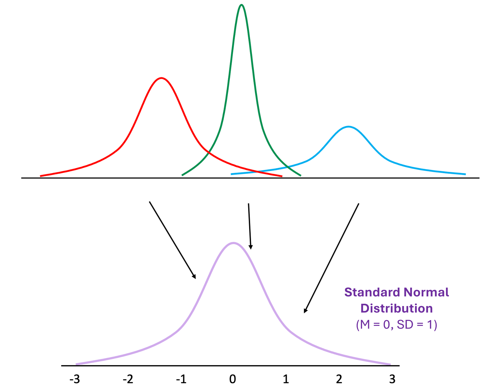
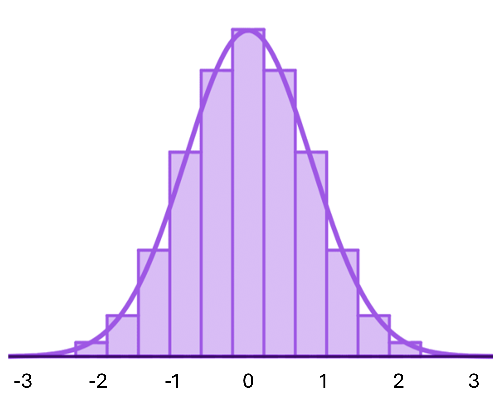
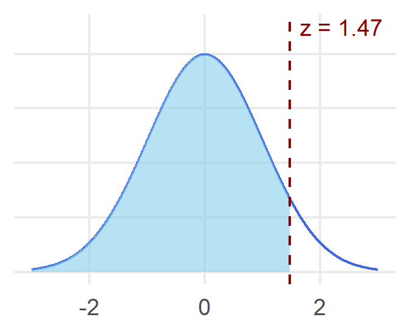
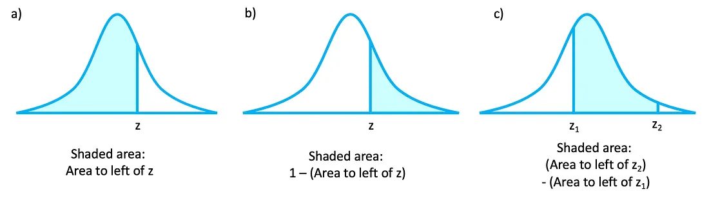
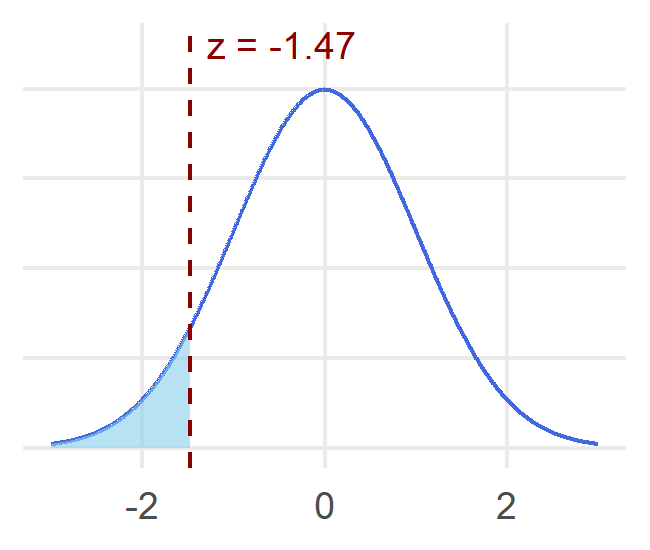
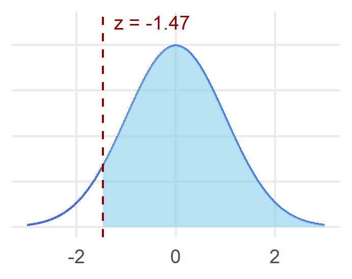
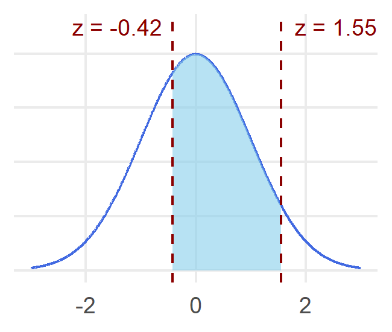
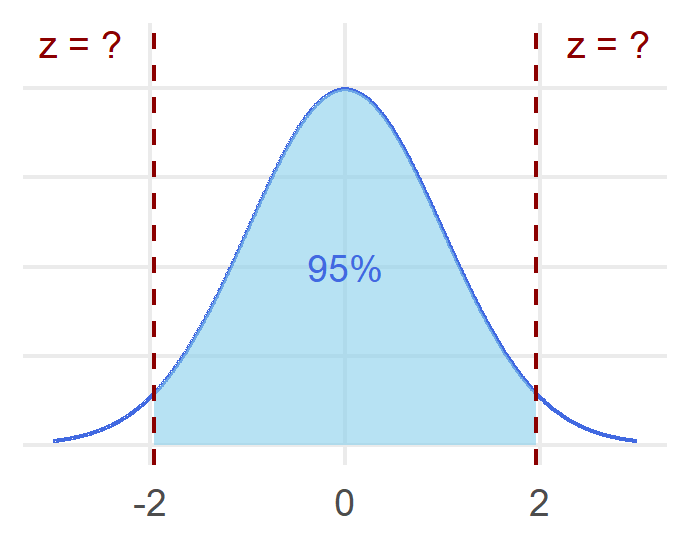



# Getting started

In this lab, we'll be using `R` to help us start working with z-scores, normal distributions and probabilities. Before starting this lab, make sure to have read **Chapter 4: z Scores: Data Distributions, the Normal Curve, and Probability** from your textbook.

::: callout-note
## Learning objectives

By the end of this lab, you should be able to:

-   Define, interpret and use `R` to calculate z-scores
-   Understand the basic properties of the normal distribution
-   Understand how z-scores relate to properties of the normal distribution
-   Interpret and use `R` to compute probabilities of events within the context of a normal distribution
:::

# z-scores

In the previous lab, we learned about various descriptive statistics that we can use to characterize the central tendency and variability of the data that we are working with. Here, we will be using the mean and standard deviation specifically to calculate a **z-score** (or **standardized score**). Using z-scores, we can transform a given value in a dataset so that it is defined by the number of standard deviations it is away from the mean. One of the biggest benefits of doing this is that it gives us a common unit to compare across when working with data that use different units of measurement.

To help us better understand what a z-score tells us, let's imagine that it's midterm season and you just got your grades back for a few of your courses. You ended up with a grade of 85 on both your Cognitive Psychology and Social Psychology courses.

How do you feel about both of these grades? The first thing you would probably want to know is the **mean** of these tests since this gives you an idea of whether you were above or below average. The next thing that would be helpful to know is the **standard deviation** of these tests since this gives you an idea of how much above or below you are doing. By calculating the z-score, you get a helpful way of describing your raw score in terms of the mean and standard deviation.

## Calculating z-scores

To calculate a z-score, we can use the following formula:

$$
z=\dfrac{X-M}{SD}
$$

In plain language, we'll first take the difference of our raw score and the mean ($X-M$). Afterwards, we'll divide this results by our standard deviation ($SD$). The resulting value is the z-score that corresponds to your given raw score.

**For this example, let's load in `sample-class.csv`, a made-up dataset with class test scores in different courses.**

```{webr}
# Use the read.csv() function to load in the example student dataset
grades <- read.csv("data/sample-class.csv")
grades
```

**We can then use the `mean()`** **and `sd()`** **functions to help us calculate the z-score corresponding to our grade of 85 relative to the other `CogPsych_Exam`** **and the `SocPsych_Exam`** **scores:**

```{webr}
# Calculate the mean and standard deviation of the CogPsych_Exam grades
mean(grades$CogPsych_Exam)
sd(grades$CogPsych_Exam)

# Calculate the mean and standard deviation of the SocPsych_Exam grades
mean(grades$SocPsych_Exam)
sd(grades$SocPsych_Exam)

# Use these values to calulate the z-score corresponding to our grade
(85 - mean(grades$CogPsych_Exam)) / sd(grades$CogPsych_Exam)
(85 - mean(grades$SocPsych_Exam)) / sd(grades$SocPsych_Exam)
```

## Interpreting z-scores

How should we interpet these z-scores? We can compare the sign and the size of the numbers:

-   The **sign** (i.e., positive or negative) of a z-score tells us whether our score is above or below the mean. In this case, our grade of 85 is above the mean in our Cognitive Psychology course, but below the mean in our Social Psychology course.
-   The **size** (i.e., absolute value) of a z-score tells us the distance from the mean, in the units of standard deviations. The larger the value, the further away a score is from the mean. In this case, our grade of 85 is over 2 standard deviations above the mean in our Cognitive Psychology course, but close to 0 standard deviations below the mean in our Social Psychology course.

## Converting between z-scores and raw scores

Using some algebra to rearrange our z-score formula, we can also derive a formula to calculate a raw score from a z-score:

$$ z=\dfrac{X-M}{SD} $$

$$ z \times SD={X-M} $$

$$ X = z \times SD+M $$

In other words, if we know what the z-score is within a given distribution, we can find the original score.

**Let's find the raw score that corresponds to a z-score of 1.5 on our `CogPsych_Exam`** **grades.**

```{webr}
# Let's calculate the original grade corresponding to a z-score of 1.5
(1.5 * sd(grades$CogPsych_Exam)) + mean(grades$CogPsych_Exam)
```

## Standardizing scores

Lastly, we can convert all of our grades to their corresponding z-scores, or **standardize** our scores, using the `scale()` function. This is especially helpful when we don't yet have a good idea of how to interpret a variable and its measurement. In addition, this helps us to identify potential outliers in our data.

As a brief aside, we previously used the `$` symbol to access variables in our dataset. However, we can also use the `$` to create new variables in our data.

**Let's use the `scale()`** **function to convert each of the grades to their corresponding z-score, which we can then store in a new variable.**

```{webr}
# Use the scale() function to convert all the grades to the corresponding z-score
# We can then assign these to a new variable in our dataset
grades$CogPsych_Exam_z <- scale(grades$CogPsych_Exam)
grades$SocPsych_Exam_z <- scale(grades$SocPsych_Exam)
grades$DevPsych_Exam_z <- scale(grades$DevPsych_Exam)

# Let's take a look at our updated dataset
grades
```

Importantly, when we are standardizing our data, all we are doing is *re-labelling* our scores, NOT *re-positioning* them. In doing so, we change some of the characteristics of our dataset:

-   The new **mean** becomes 0, providing a convenient reference point
-   The new **standard deviation** becomes 1, providing a standard unit of comparison
-   The new **shape** is the same as it was originally. If the original distribution was normal, the standardized distribution will be normal. Likewise, if the original distribution was skewed, the standardized distribution will still be skewed.

::: callout-tip
## Activity 1

Let's use `ggplot2` to create a few histograms to help us visualize how our original and standardized distributions compare to one another. Fill in the blanks below to first create a histogram of the original scores (e.g., `CogPsych_Exam`, `SocPsych_Exam`, or `DevPsych_Exam`). Then compare this to the histogram of the standardized scores (e.g., `CogPsych_Exam_z`, `SocPsych_Exam_z`, or `DevPsych_Exam_z`). What stays the same? What changes?
:::

**First, install and load in the `ggplot2`** **package to help us make our histograms.**

```{webr}
# Download and load in the ggplot2 package (this might take a few moments)
install.packages("ggplot2", quiet = TRUE)
library(ggplot2)
```

**Next, let's use `ggplot2`** **to create a few histograms to compare our original and standardized distributions.**

```{webr}
#| exercise: ex_1
# Let's first make a histogram of one of the original exam score distributions
# e.g., CogPsych_Exam, SocPsych_Exam, DevPsych_Exam
grades |>
  ggplot(aes(x = ______)) +
  geom_histogram(bins = 10)
  
# Then make a histogram of one of the corresponding standardized distributions 
# e.g., CogPsych_Exam_z, SocPsych_Exam_z, DevPsych_Exam_z
grades |>
  ggplot(aes(x = ______)) +
  geom_histogram(bins = 10)
```

# The normal distribution

So far, we've been working with z-scores to describe scores relative to their distribution. However, one of the most helpful applications of the z-score is that it allows us to find its corresponding **probability**, or how likely is that we obtain a given outcome. Specifically, this will be the case when our data comes from a **normal distribution**. The normal distribution is one of the most commonly occurring distributions that we'll come across in psychology (and other natural and social sciences).

All normal distributions are going to share some common properties:

-   Normal distributions are bell-shaped (i.e., the *bell curve*) and symmetrical about the center
-   Normal distributions are unimodal, with the mean, median and mode being equal in the center
-   The tails of the normal distribution extend to infinity in both directions, and are not anchored to the axes

Technically, we can have an *infinite* number of normal distributions, each varying based on their means and standard deviations. Fortunately, we can compute a **standard normal distribution** by converting scores to their corresponding z-scores, which gives us a common frame for comparison:

{fig-alt="Illustration showing different normal distributions varying on their means and standard deviations being converted to the standard normal distribution."}

Importantly, the normal distribution is a **probability distribution**, meaning that we can define the normal distribution by proportions, or percentages, that fall in the area under the curve. One helpful way to think of this is to imagine the normal distribution overlaid on a histogram, you can find the proportion of values corresponding to a given region.

{fig-alt="A normal distribution overlaid on top of a histogram."}

With this in mind, there are a few general properties regarding the probability of the standard normal distribution:

-   The area under the entire curve is always equal to 1 (or 100%) – in other words, your value has to be one of the possible values
-   Because our normal curve is symmetrical, the mean splits the distribution in half so that 0.5 (or 50%) will fall above the mean, and 0.5 (or 50%) will fall below the mean.
-   In a similar manner, we can find the proportion (or percentage) of scores that falls above or below *any single score* on our standard normal distribution.
-   We can also figure out the proportion or percentage of scores between *any two scores*. For example, a helpful rule of thumb is the **empirical rule** (sometimes also called the *68-95-99.7 rule* or the *1-2-3 rule*) which states that in a normal distributor, \~68% of your data falls within ±1 standard deviations of the mean, \~95% within 2 standard deviations, and \~99.7% within 3 standard deviations of the mean.

# Probabilities and the normal distribution

Using the normal distribution, we can then answer two types of problems:

-   What is the probability of getting a score that falls above, below, or between particular z-scores?
-   What z-score is associated with particular probabilities?

To do so, we can use a **z-table** (or *unit normal table*) to tell us the proportions of the normal distribution for a full range of z-scores. Importantly, we do NOT calculate the probability of obtaining a *specific* z-score. Rather, we can think of a z-score as fence in our distribution that divides our distribution into two parts. Oftentimes, the larger portion is referred to as the **body** and the smaller portion is referred to as the **tail**. Remember that both of these sections should always add up to 1 because the area under the curve is always equal to 1.

As an example, let's say that we want to find the probability of getting a score below z = 1.47. The first thing that is always helpful to do is to draw a curve, just so that you can visualize which region you are looking for.

{fig-alt="Normal distribution with a vertical line at z = 1.47, with scores less than this cutoff being depicted by a shaded region."}

To find this shaded region, we can do so either by hand using our **z table** (or unit normal table), or with `R` using the `pnorm()` function. In both cases, we can find the area to the left of a given z-score in our normal distribution.

**Let's try using the `pnorm()`** **function to find the probability of getting a score below z = 1.47.**

```{webr}
# Use the pnorm() function to find the area left of a given z-score
pnorm(1.47)
```

What this value tells us is that 92.9% of scores in our distribution are less than z = 1.47. Note that this value is the **percentile** corresponding to z = 1.47, which tells you the percentage of the scores in your data that falls at or below a given value. If you've taken a standardized test before, you may have come across this term before. In this case, if you scored in the 99th percentile, that means that your performed in the top 1%.

Here, we can also work backwards to find the z-score corresponding to a given percentile on our standard normal distribution by using the `qnorm()` function, which is the inverse of the `pnorm()` function above.

**Let's use the `qnorm()`** **function to find the z-score corresponding to the 99th percentile in the standard normal distribution.**

```{webr}
# Use the qnorm() function to find z-score corresponding to a given percentile
qnorm(0.99)
```

The `pnorm()` function only tells us the proportion of scores *below* a given z-score and similarly, the `qnorm()` function only tells us the z-score corresponding to a given percentile (i.e., percentage of scores *below* a given value). However, we can use these functions to find *any* area under the standard normal distribution since all of the sections under the curve has to equal 1 (or 100%). As a helpful reference, the figure below shows you can puzzle together the areas associated with different regions of the normal distribution.

{fig-alt="Diagram showing how to calculate different areas under a normal distribution. Panel A depicts the area to the left of a z value. Panel B depicts the area to the right of a z value, which you can calculate by subtracting the area to the left of z from 1. Panel C depicts the area between two z values, which you can find by subtracting the area to the left of the first z value from the area to the left of the second z value."}

::: callout-tip
## Activity 2

Try finding the values corresponding to the standard normal distribution below using the `pnorm()` and `qnorm()` functions. For the questions below, I'll also provide some corresponding pictures to help, but you should be comfortable drawing these for yourself too.
:::

```{webr}
#| exercise: ex_2a
# What is the probability of getting a score below z = -1.47?
______
```

::: column-margin
{fig-alt="Normal distribution with a vertical line at z = -1.47, with scores less than this cutoff being depicted by a shaded region."}
:::

```{webr}
#| exercise: ex_2a
#| check: true 
if (identical(.result, pnorm(-1.47))) {   
  list(correct = TRUE, message = "✅ Nice work!") 
} else {   
  list(correct = FALSE, message = "❌ Hmm... try again!") 
}
```

------------------------------------------------------------------------

```{webr}
#| exercise: ex_2b
# What is the probability of getting a score above z = -1.47? 
______
```

::: column-margin
{fig-alt="Normal distribution with a vertical line at z = -1.47, with scores greater than this cutoff being depicted by a shaded region."}
:::

```{webr}
#| exercise: ex_2b
#| check: true 
if (identical(.result, 1 - pnorm(-1.47))) {   
  list(correct = TRUE, message = "✅ Nice work!") 
} else {   
  list(correct = FALSE, message = "❌ Hmm... try again!") 
}
```

------------------------------------------------------------------------

```{webr}
#| exercise: ex_2c
# What is the probability of getting a score between z = -0.42 and z = 1.55?
______
```

::: column-margin
{fig-alt="Normal distribution with vertical lines at z = -0.42 and z = 1.55, with scores between these cutoffs being depicted by a shaded region."}
:::

```{webr}
#| exercise: ex_2c
#| check: true 
if (identical(.result, pnorm(1.55) - pnorm(-0.42))) {   
  list(correct = TRUE, message = "✅ Nice work!") 
} else {   
  list(correct = FALSE, message = "❌ Hmm... try again!") 
}
```

------------------------------------------------------------------------

```{webr}
#| exercise: ex_2d
# What z-scores separate the middle 95% of the distribution from the remaining 5%?
# For your response, you ONLY need to find the positive z-score
______
```

::: column-margin
{fig-alt="Normal distribution with vertical lines at two z values, with scores in the middle 95% depicted by a shaded region."}
:::

```{webr}
#| exercise: ex_2d
#| check: true 
if (identical(.result, qnorm(0.975))) {   
  list(correct = TRUE, message = "✅ Nice work!") 
} else {   
  list(correct = FALSE, message = "❌ Hmm... try again!") 
}
```

Although our empirical rule gives us a rough rule of thumb, this provides the exact values that separate our middle 95% from the rest of the distribution. Note that there are actually two z-scores here, but because our normal distribution is symmetrical, it will just be the positive and negative version of the same value.

# Using the standard normal distribution

Using z-scores and the standard normal distribution allows us to find the probabilities corresponding to a specific score (and similarly, the scores corresponding to a specific probability) for **any** normally distributed variable. To do so, we just need to take the intermediate step of finding the associated z-score first. However, remember that this **only** works if the original distribution is normally distributed – when we standardize a variable, it keeps its original shape.

For example, let's say that you were interested in applying to graduate school. As part of the application process, you may be asked to take the GRE (Graduate Record Examination, a standardized test that aims to measure your verbal reasoning, quantitative reasoning, and analytical writing. Scores on the Verbal Reasoning and Quantitative Reasoning measures are normally distributed, with the mean being \~155 points and the standard deviation being \~8.5 points. What is the probability of a student scoring less than 165 points on the Verbal Reasoning measure? To do so, we need to first calculate the z-score corresponding to a score of 165 points in our distribution (i.e., $z=\dfrac{X-M}{SD}$). Then we can use this to find the proportion of values below this z-score on the standard normal distribution.

**Let's find the probability of scoring less than 165 on the GRE Verbal Reasoning measure. First, we'll compute the corresponding z-score in our original distribution. Then we'll find the proportion of values below this z-score on the standard normal distribution using `pnorm()`. Try drawing the associated curve to help you visualize what region you are looking for.**

```{webr}
# First, calculate the z-score and assign it to an object
# For the GRE Verbal Reasoning measure, the mean is 155 and the SD is 8.5
z <- (165 - 155) / 8.5

# Then use pnorm() to find the probability of scoring less than this z-score
pnorm(z)
```

::: callout-tip
## Activity 3

For our last activity, let's return back to the sample class test scores we worked with at the beginning of this lab, stored in the `grades` object. Fill in the code block below to find the probability of getting a grade between 60 and 80 on the `CogPsych_Exam` (you can assume that scores on the `CogPsych_Exam` are normally distributed. You'll be asked to submit this in the corresponding CourseLink Assignment.

As a few hints:

-   Use the `$` operator to access variables in your data (i.e., `grades`)
-   Probabilities should never be negative (i.e., they should always be between 0 - 1, or 0% to 100%)
-   Don't forget to draw the associated curve to help you visualize what region you are looking for!
:::

```{webr}
#| exercise: ex_3
# What is the probability of getting between 60 and 80 on the CogPsych_Exam?
# As a hint, first, find the z-scores
z1 <- ______
z2 <- ______

# Then, find the associated probabilities to calculate the region you are looking for
______
```

# That's all for now, great work!

**Use what you have learned to answer some questions about this lab in the corresponding Assignment on CourseLink!**
