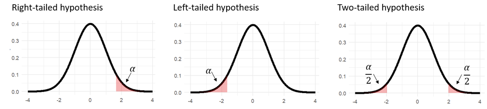



# Getting started

In this lab, we'll start to explore how we can use data from a sample to make claims about its associated population. Before starting this lab, make sure to have read **Chapter 5: Sampling, the Central Limit Theorem, and Hypothesis Testing** from your textbook.

::: callout-note
## Learning objectives

By the end of this lab, you should be able to:

-   Define what a sampling distribution is, particularly the distribution of sample menas
-   Define what the central limit theorem is, particularly in reference to the mean, standard deviation, and shape of the distribution of sample means
-   Describe how changing the sample size affects the distribution of sample means
-   Define, interpret and use `R` to calculate standard errors
-   Describe why the central limit theorem is important in statistics, particularly in null hypothesis significance testing (NHST)
-   Use `R` to conduct and interpret a z-test
:::

# From populations to samples

Up to this point, we've primarily been working with statistics to describe a given set of data (i.e., **descriptive statistics**). However, one of the most powerful uses of statistics is the ability to make claims, or inferences, about a population of interest based on data from a smaller sample of individuals from that same population (i.e., **inferential statistics**).

## Population parameters and sample statistics

As psychologists, we are almost always interested in drawing conclusions about a **population**, or a very large group of people (e.g., all undergraduate students in Canada, all Canadians, all human beings, etc.). Despite this, we are almost always working with a **sample** (e.g., participants in a study) because it would not possible to get data on every single person in our population.

As an example, let's imagine that we are working with IQ scores. These are designed so that at the population level, the distribution of scores is normal with a mean IQ score of 100 and a standard deviation of 15. These values are referred to as population **parameters** because these are characteristics of the population. Population parameters are oftentimes denoted by using lowercase Greek letters, with μ (mu) being used for population means and σ (sigma) being used for population standard deviations.

**For our example, let's imagine that we are interested in IQ scores for the entire population of the fictional city of Springfield. Before we start, let's first run the code below to prep us for the lab**[^1]**.**

[^1]: You may notice that we're just installing one package called `tidyverse`. The `tidyverse` is a collection of packages that share a common way of thinking and working with data, which provides a more modern workflow for using `R`. The `tidyverse` encompasses many helpful packages including ones that we've used before, such as `dplyr` for data wrangling and and `ggplot2` for data visualization.

```{webr}
# Download and load the tidyverse package (this might take a few moments)
install.packages("tidyverse", quiet = TRUE)
library(tidyverse)

# Last, we'll set a seed to help with reproducing our results
set.seed(519)
```

**Next, let's set up and visualize the IQ scores for the underlying population of 1,000,000 people in Springfield. Do not worry if you don't understand all the code below. As an important note, remember that we practically NEVER actually observe this!**

```{webr}
# Let's first specify what our true population parameters are
population_mean <- 100
population_sd <- 15
population_n <- 1000000

# Next, create a dataset consisting of our population IQ scores
population_data <- tibble(iq = round(rnorm(n = population_n, mean = population_mean, sd = population_sd)))

# Last, create a histogram to visualize our population data
population_data |>
  ggplot(aes(x = iq)) +
  geom_histogram(bins = 50, fill = "goldenrod1") +
  labs(title = "Population distribution of IQ scores in Springfield",
    x = "IQ",
    y = "Frequency") +
  theme_minimal()
```

Let's then imagine that we are working with Professor Frink, the local scientist in Springfield, to run a study where we are have participants complete an IQ test. Let's compare the mean IQ scores after we collect two samples, one with 5 and one with 100.

::: column-margin
{fig-alt="Professor Frink, a cartoon character from the Simpsons, sitting at his desk."}
:::

**Here, we'll use the `slice_sample()`** **function, which let's us randomly select a number of rows from our dataset.**

```{webr}
# First, let's collect a sample of n = 5 and calculate the sample mean
population_data |>
  slice_sample(n = 5) |>
  summarise(sample_mean = mean(iq))
  
# Then, we'll collect a sample of n = 100 and calculate the sample mean  
population_data |>
  slice_sample(n = 100) |>
  summarise(sample_mean = mean(iq))
```

These mean values that we just calculated are referred to as sample **statistics** since these are properties of our sample data. The first thing to note is that both of these are pretty close to our population mean of 100 – this makes intuitive sense because these samples are collected to approximate our population. The other thing to note is that our second sample is closer to our actual population mean. This is a demonstration of the **law of large numbers**, which says that more observations gives us a better approximation of the true average.

Regardless, in either case, we don't get the *exact* population parameter of 100. In fact, there will always be some degree of imprecision between our sample statistic and our population parameter, which is referred to as **sampling error**. This sampling error can be exacerbated if we have some form of **sampling bias** when we are selecting our participants, but will occur naturally even if we have a perfectly **representative sample**.

## Sampling distributions

If it's the case that we will always encounter some form of sampling error, then how do confidently make inferences about our population? To explore how we are able to do so, let's imagine that we decide to **replicate** our study. In other words, we will obtain a random sample of 5 people and have them complete our IQ test. We will then do this again and again and again, replicating our study 5,000 times.

**Run the code below to see what happens when we replicate our study. Don't worry about understanding the nuts and bolts of the code. We'll then look at the first few replications.**

```{webr}
# For each study, we'll gather a sample size of 5
# We'll then replicate our study 5000 times (this might take a few moments)
replicated_data_5 <- as_tibble(t(replicate(5000, population_data |>       
                                          slice_sample(n = 5) |> 
                                          pull(iq))), 
                              .name_repair = ~ paste0("participant_", 1:5)) |> 
                    mutate(replication = paste0("replication_", 1:5000), .before = 1) |> 
                    mutate(sample_mean = rowMeans(across(starts_with("participant"))))

# We'll then use the head() function to take a peek at our first few replications
head(replicated_data_5)
```

In the table above, we can see that each row corresponds to the results of one of our replications, with each column being the score of a given participant. Each time we run our study, we calculate a new `sample_mean`. As we noted before, this sample mean will always be a little bit off of our population parameter of μ = 100. However, notice what happens when we plot the results of each of the values in our `sample_mean` column.

**We'll make a histogram that visualizes all of the values in our `sample_mean`** **column, which takes the mean of each of our replications.**

```{webr}
# Let's create a histogram to visualize our population data
replicated_data_5 |>
  ggplot(aes(x = sample_mean)) +
  geom_histogram(bins = 50, fill = "deepskyblue") +
  labs(title = "Distribution of sample means (n = 5)",
    x = "Sample mean",
    y = "Frequency") +
  coord_cartesian(xlim = c(70, 130)) +
  theme_minimal()
```

What can we take away from this image? What we see is that our `sample_mean` for a given replication tends to be between 80 and 120. What this means is that sometimes we'll get a sample that happens to have a lower average IQ score (around 80) and other times, we'll get a sample that happens to have a high average IQ score (around 120). However, for the most part, we see that the scores form a normal distribution centered around a mean of 100 – in other words, our population mean! As we mentioned earlier, increasing our sample size gives us a better estimate of what our population parameter is.

**Let's see what happens when we repeat the same process, but this time, we'll obtain a random sample of 100 people instead of 5.**

```{webr}
# For each study, we'll gather a sample size of 100
# We'll then replicate our study 5000 times (this might take a few moments)
replicated_data_100 <- as_tibble(t(replicate(5000, population_data |>       
                                             slice_sample(n = 100) |> 
                                             pull(iq))), 
                                 .name_repair = ~ paste0("participant_", 1:100)) |> 
                    mutate(replication = paste0("replication_", 1:5000), .before = 1) |> 
                    mutate(sample_mean = rowMeans(across(starts_with("participant"))))
                    
# Let's create a histogram to visualize our population data
replicated_data_100 |>
  ggplot(aes(x = sample_mean)) +
  geom_histogram(bins = 10, fill = "deepskyblue") +
  labs(title = "Distribution of sample means (n = 100)",
    x = "Sample mean",
    y = "Frequency") +
  coord_cartesian(xlim = c(70, 130)) +
  theme_minimal()
```

How does this histogram compare to the one we created earlier? In both cases, we see that our scores again form a normal distribution centered around a mean of 100. However, because we are getting a better estimate, notice that our scores are more tightly clustered around this mean – rather than ranging from 80 and 120, our distribution now ranges between 95 and 105.

The histograms that we just plotted shows a special kind of distribution, called **the distribution of sample means**. This is a theoretical distribution of our sample means if we were to obtain *every single* *possible* sample of a given size[^2]. The reason this is theoretical is because it would be impossible to obtain every single possible sample. Nonetheless, we can understand what the distribution of sample means will look like due to one of the most important theorems in statistics...

[^2]: Technically, we can make a **sampling distribution** for any statistic, not just the mean. However, the distribution of sample means is the most common one to talk about since it underlies many of the statistical tests that we are learning about.

# The central limit theorem

Despite how poorly a single small sample can do to approximate a population parameter, we can see that together, *many* small samples will stack up to create a distribution that is **centered around the true population parameter**.

In addition, we see that we can decrease the variability of our distribution of sample means by increasing the sample size. Just like we had done previously, we can quantify this variability by calculating the standard deviation of the sampling distribution – in the context of the distribution of sample means, this value has a special name and is referred to as the **standard error (SE)**.

The last note is that we see that our distribution of sample means is **normally distributed**. Is this just because the IQ scores in the population of Springfield was normally distributed to begin with?

::: callout-tip
## Activity 1

Let's try looking at the distribution of sample means for a new variable called `special_trait`. The important thing here is that you can tweak the distribution shape of `special_trait` in the population.

-   First, set the `distribution_shape` to be either `normal`, `pos_skew`, `neg_skew`, `uniform`, or `bimodal` and run the first code block below to get the population distribution of your `special_trait`
-   Next, adjust the `sample_size` to see how your distribution of sample means changes in response to different sample sizes.
-   You can run these more than once to see what happens in each case with different combinations of values. What happens when the population shape is normal vs. non-normal? What happens when you use a small sample size (e.g., n = 1) and slowly make it bigger (e.g., n = 100)?
:::

**First, choose the `distribution_shape` of `special_trait`** **in the population of Springfield. This can be either `normal`, `pos_skew`, `neg_skew`, `uniform`, or `bimodal`. The dashed black line denotes the population mean (μ).**

```{webr}
#| exercise: ex_1a
#| envir: ex_1
# Choose a distribution shape for your population
# This can be either "normal", "pos_skew", "neg_skew", "uniform", or "bimodal"
distribution_shape <- "______"
  
# DON'T WORRY (OR ADJUST) THE CODE BELOW
# The code below makes population distribution based on the shape you chose
# First, create a dataset consisting of our population data
special_trait_pop <- if(distribution_shape == "normal") {
  tibble(special_trait = rnorm(1000000, mean = 15, sd = 3))
} else if(distribution_shape == "pos_skew") {
  tibble(special_trait = rgamma(1000000, shape = 2, scale = 2))
} else if(distribution_shape == "neg_skew") {
  tibble(special_trait = 30 - rgamma(1000000, shape = 2, scale = 2))
} else if(distribution_shape == "uniform") {
  tibble(special_trait = runif(1000000, min = 0, max = 10))
} else if(distribution_shape == "bimodal") {
  tibble(special_trait = c(rnorm(500000, mean = 10, sd = 2.5), rnorm(500000, mean = 20, sd = 2.5)))
}

# Last, create a histogram to visualize our population data
special_trait_pop |>
  ggplot(aes(x = special_trait)) +
  geom_histogram(bins = 50, fill = "tomato") +
  geom_vline(aes(xintercept = mean(special_trait)), linetype = "dashed",
             color = "black") +
  labs(title = "Population distribution of the Special Trait in Springfield",
    x = "Special Trait",
    y = "Frequency") +
  theme_minimal()
```

**Next, set the sample size below. Your sample needs to be between 1 and 1,000,000 (the population size of Springfield), but you will likely get errors if you make this number too big! The dashed black line denotes the mean of your distribution of sample means.**

```{webr}
#| exercise: ex_1b
#| envir: ex_1
# Choose a sample size -- your sample needs to be between 1 and 1,000,000
# Note that you will likely get errors if you make this number too big!
sample_size = ______

# DON'T WORRY (OR ADJUST) THE CODE BELOW
# The code below makes a sampling distribution of means from your population data
# We'll replicate our study 5000 times (this might take a few moments)
replicated_data <- tibble(
  replication = paste0("replication_", 1:5000),
  sample_mean = replicate(5000, {
    mean(sample(special_trait_pop$special_trait, size = sample_size, replace = TRUE))
  })
)
                    
# Let's create a histogram to visualize our population data
replicated_data |>
  ggplot(aes(x = sample_mean)) +
  geom_histogram(fill = "springgreen") +
  geom_vline(aes(xintercept = mean(sample_mean)), linetype = "dashed",
             color = "black") +
  labs(title = "Distribution of sample means",
    x = "Sample mean",
    y = "Frequency") +
  theme_minimal()
```

What we just demonstrated are the basis of the **central limit theorem**, which tells us key characteristics of our distribution of sample means – specifically, the shape, mean, and standard deviation:

-   The **shape** of the distribution of sample means will be normally distributed if the original population is also normally distributed. It will also be normal for **ANY** population distribution shape, as long as your sample size is sufficiently large, with a sample size of 30 being used as a rough rule of thumb[^3].
-   The **mean** of the distribution of sample means will be equal to your population mean, μ.
-   The **standard deviation** of the distribution of sample means is the **standard error (SE)**, which is equal to $\dfrac{\sigma}{\sqrt{n}}$ , where $\sigma$ is your population standard deviation and $n$ is your sample size. In general, we want a smaller standard error since this means we have a more precise estimate. This can happen when our variable of interest inherently has a small standard deviation or if we obtain a bigger sample size.

[^3]: If you want to try this out with other population distribution shapes, you can visit the demonstration here, where you can draw out any shape you like: <https://onlinestatbook.com/stat_sim/sampling_dist/index.html>

**Think back to the IQ scores in our population, which are normally distributed with a population mean, μ = 100, and a population standard deviation, σ = 15. Let's find the standard error for our previous examples, using a sample size of n = 5 and n = 100.**

```{webr}
# Let's calculate our standard error when n = 5
15 / sqrt(5)

# Let's calculate our standard error when n = 100
15 / sqrt(100)
```

# Introduction to hypothesis testing

As we alluded to previously, the central limit theorem is one of *the most important* aspects underlying our ability to do inferential statistics. What is so important about it though?

We practically never have access to our entire population, so as a result, we have to rely on samples. With the central limit theorem, we know that (1) our sample mean can be a trustworthy estimate of the underlying population mean, (2) we can quantify how trustworthy of an estimate our sample provides (i.e., with our standard error), and (3) we can identify situations where our distribution of sample means will be normal (i.e., when our population distribution is normal, or if our sample size is ≳30).

These form the basis for our ability to make statistical inferences, specifically using **null hypothesis significance testing (NHST)**. NHST is a general framework that encompasses many of the different tests that we will be learning in this course (e.g., t-tests, ANOVAs, etc.) The logic underlying NHST can be a bit tricky, but it allows us to evaluate our hypotheses about a population using sample data.

As an example, let's say that we wanted to test out whether our innovative 8-week study program would improve IQ scores in our population of Springfield. We collect a sample of $n=25$ participants, have them go through our program and subsequently complete an IQ test. We find that our sample has a mean IQ score of $M=108$ – IQ scores went up after taking our program!

::: column-margin
{fig-alt="Bart Simpson, a cartoon character from the Simpsons, raising his hand in class."}
:::

However, we cannot take any differences at face value. Due to sampling error, we will expect that our sample mean will never be exactly equal to the population mean μ. Rather, what we will do is determine whether the difference is **statistically significant**, or unlikely to happen due to chance given that the null hypothesis was true. We do so by determining the probability of obtaining our sample in relation to the distribution of sample means, which we can do thanks to the central limit theorem!

Let's describe the logic behind using NHST to test our hypothesis. This is done through five steps:

1.  First, we **state our hypotheses.** Specifically, we have two mutually exclusive hypotheses. We first start off with the **null hypothesis (**$H_0$**)** as our basis, which states that we should expect *no difference* because whatever we are interested in actually has no effect. Conversely, the **alternative hypothesis (**$H_1$ or $H_A$**)** states that *there is a difference* because whatever we are interested in actually does have an effect.

    When stating our alternative hypothesis, this can either be **directional**, if we state that the direction of the difference (e.g., bigger or smaller), or **non-directional**, if we state that there will simply be a difference. In practice, non-directional alternative hypotheses are much more commonly used than non-directional alternative hypotheses.

    ::: callout-important
    ## Important!

    Null hypothesis significance testing is is a bit counter-intuitive since *we begin with the assumption of the null hypothesis*, but we are really interested in seeing whether our effect of interest actually exists. Our goal here is to see whether our data provides us with enough evidence to discredit this initial assumption.

    Crucially, we can **never** prove a hypothesis. Rather, we are seeking to find evidence that it is unlikely that our null hypothesis is true. As such, the language we use to describe our findings is important. We never say that we "proved" or "accepted" our null hypothesis – rather, we either "reject" or "fail to reject" our null hypothesis.
    :::

2.  Next, we **create our decision rule.** Now that we have our hypotheses, how do we determine whether our data rejects or fails to reject our null hypothesis? What we do is determine the probability of obtaining our given sample if there was no effect. To do so, we use our distribution of sample means to tell us what values are likely or unlikely to be obtained, given that the null hypothesis is true.

    We determine that something is but setting our **α (alpha level)**, which determines the significance level of our hypothesis test. A common convention is to set an α = .05, but this can be any probability value. With an α = .05, we separate the most unlikely 5% of our sample means from the 95% most likely sample means.

    This allows us to identify our **critical value(s)**, which establish the boundaries for our **critical region(s)**. These are the tail(s) of our distribution and contain the sample means that would be very unlikely to occur due to chance if our null hypothesis was true. If we are conducting a non-directional, or **two-tailed**, test, there will be two tails since we are only interested in whether our difference exists. If we are conducting a a directional, or **one-tailed**, test, there will be one tail, either on the left or right, since we expect that the difference will be either smaller or bigger, respectively.

    To establish these values, we can use what we learned previously with our z-scores and normal distributions. We can do this because with the central limit theorem, we can identify scenarios where we can *guarantee* that our distribution of sample means is normal. As a reminder, it is very helpful to draw the associated curve to help you visualize what values you are looking for!

    {fig-alt="Diagram showing critical regions on a normal distribution for different types of hypothesis tests. The first panel shows a right-tailed hypothesis, with the critical region in the right tail. The second panel shows a left-tailed hypothesis, with the critical region in the left tail. The third panel shows a two-tailed test, with critical regions in both the left and right tails."}

3.  Then, we **compute our observed test statistic.** Next, we need to find how our sample compares to these decision criteria. This is established by a value called the **test statistic** and associated **p-value** (or **probability value**). This test statistic pinpoints our sample on the distribution of sample means, and accordingly, we can find the probability of obtaining said value.

    There are many different test statistics, but we'll be starting with the **z-test**. We use the z-test when we are comparing our sample to a population where we know the mean, μ and standard deviation, σ. In essence, we are finding the z-score that corresponds to our sample on the distribution of sample means. Because we are working with our distribution of sample means, we use the standard error to calculate this:

    $$
    z=\dfrac{M-\mu}{SE},\ where\  SE=\dfrac{\sigma}{\sqrt{n}}
    $$

    We can then find the corresponding probability value associated with the value, or p-value. The p-value tells us the likelihood of obtaining a result at least as extreme as our sample data, given the null hypothesis is true. Remember, this is NOT the probability that our null hypothesis is true!

4.  Lastly, we **make a decision.** Now that we have all our pieces in place, the last thing that we need to do is to make a decision regarding our null hypothesis. Here, we have two outcomes. If our test statistic is in the critical region, we *reject* the null hypothesis (i.e., it would be extremely unlikely that we got our sample solely due to chance if there was actually no effect). If our test statistic is not in the critical region, we *fail to reject* the null hypothesis (i.e., it is possible that we got our sample due to chance if there was actually no effect).

5.  After making a decision, we need to actually **report our results** and talk about how it relates back to our initial hypotheses. We will introduce formal APA-style reporting later on in this course, but for the time being, know that it is critical to also know how to communicate what we find in our analyses!

::: callout-tip
## Activity 2

Now it's your turn! Let's apply these five steps of NHST to test whether our new study program has an effect on IQ scores in our population of Springfield.
:::

1.  In plain words, what are the statistical hypotheses? What are the null and alternative hypotheses? What would a non-directional, or two-tailed, hypothesis look like? How about a directional, or one-tailed, hypothesis?

2.  Using an α = .05, what are the critical value(s)? In essence, what we are trying to find are the z-scores that separate the extreme 5% of our distribution into the tail(s). As a hint, we did this in our last lab using the `qnorm()` function, but you should be able to do this using the unit normal table too. Don't forget to draw the associated curve to help you visualize what you are looking for!

    **Use the code block below to use the `qnorm()`** **function to identify the critical values. What does this look like for a non-directional, or two-tailed, test? How about a directional, or one-tailed, test? Note that the code block below will not indicate whether you have the correct or incorrect response since you can use it to find multiple answers.**

    ```{webr}
    #| exercise: ex_2a
    # Using an α = .05, what are the critical value(s)?
    # What would this look like for a two-tailed vs. a one-tailed test?
    qnorm(______)
    ```

3.  What is the observed test statistic? As a reminder, we collected a sample of $n=25$ participants, have them go through our program and subsequently complete an IQ test. We find that our sample has a mean IQ score of $M=108$. We know that IQ scores are normally distributed in the population with a $\mu=100$ and $\sigma=15$. Since we know the population mean and standard deviation, we will use our z-test:

    $$
    z=\dfrac{M-\mu}{SE},\ where\  SE=\dfrac{\sigma}{\sqrt{n}}
    $$

    **Use the code blocks below to calculate the observed test statistic. We need to first calculate the standard error because we are working the distribution of sample means.**

    ```{webr}
    #| exercise: ex_2b
    #| envir: ex_2
    # First, calculate the standard error
    se <- ______ / sqrt(______)
    se
    ```

    ```{webr}
    #| exercise: ex_2b
    #| check: true 
    if (identical(.result, (15 / sqrt(25)))) {   
      list(correct = TRUE, message = "✅ Nice work!") 
    } else {   
      list(correct = FALSE, message = "❌ Hmm... try again!") 
    }
    ```

    **Next, use the `se` object that you just created to find the observed z-value.**

    ```{webr}
    #| exercise: ex_2c
    #| envir: ex_2
    # Next, calculate the observed z-value
    z <- (______ - ______)/ ______
    z
    ```

    ```{webr}
    #| exercise: ex_2c
    #| check: true 
    if (identical(.result, ((108 - 100) / se))) {   
      list(correct = TRUE, message = "✅ Nice work!") 
    } else {   
      list(correct = FALSE, message = "❌ Hmm... try again!") 
    }
    ```

4.  Based on these results, will you reject or fail to reject the null hypothesis? How does your observed test statistic compare to your decision criteria? Would you consider your results statistically significant? In plain words, how would you describe the results of your analyses?

# That's all for now, great work!

**Use what you have learned to answer some questions about this lab in the corresponding Assignment on CourseLink!**
