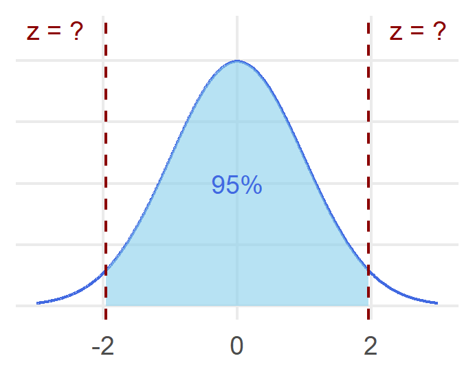



# Getting started

In this lab, we'll use `R` to start working with effect sizes and confidence intervals. Before starting this lab, make sure to have read **Chapter 6: Effect Sizes and Confidence Intervals** from your textbook.

::: callout-note
## Learning objectives

By the end of this lab, you should be able to:

-   Understand the outcomes and limitations of null hypothesis significance testing (NHST)
-   Define and differentiate between Type I (false positive) and Type II (false negative) errors
-   Define, interpret and use `R` to calculate Cohen's *d*, as a measure of effect size
-   Define, interpret and use `R` to calculate confidence intervals
:::

# Beyond p-values: Effect sizes and confidence intervals

In the last lab, we saw how we can use data to test hypotheses, specifically using null significance hypothesis testing (NHST). With this approach, we arrived at a p-value, which we used to help us decide whether we think it is likely or unlikely it is to arrive at our sample data, given that the null hypothesis is true. However, a common criticism of this approach is that it encourages simple, dichotomous thinking: either we reject, or fail to reject, our null hypothesis. In doing so, we neglect a lot of additional information in our data that might help to contextualize our findings.

## Two types of errors

::: column-margin
{fig-alt="Bart Simpson, a cartoon character from the Simpsons, raising his hand in class."}
:::

To illustrate this, let's go back to our example from last week where we tested out whether our new 8-week study program would improve IQ scores in our population of Springfield. To do so using our hypothesis testing procedure, we discussed going through five steps of:

1.  Stating our hypotheses
2.  Creating our decision rule
3.  Computing our observed test statistic
4.  Making a decision
5.  Reporting our results

As part of this process, we mentioned how we usually set an **alpha level, α** = .05 to determine the significance level of our hypothesis test. This means that any value that is part of the 5% most extreme sample means given the null hypothesis will be treated as unlikely. If we obtain this unlikely value, we deem our result to be **statistically significant** and make the decision to reject our initial assumption of the null hypothesis.

However, the world is messy, so there will be always be a chance that we make an incorrect decision. With an α = .05, there are still 5% of values that would be as extreme if our null hypothesis were true, just by chance. If we were to reject the null hypothesis when it is in fact true, we would be making a **Type I** **error**, or **false positive**. In our example, this would be concluding that our study program improves IQ scores, when in reality, it does not.

The probability of committing a Type I error, or false positive, is determined by our α. If this is the case, why do we not make our α smaller? As we mentioned previously, our decision rule can be set to whatever value we wish. For example, we could set an α = .01 so that we treat the extreme 1% of our sample means as unlikely, or α = .001, so that we treat the extreme .01% of our sample means as unlikely. This makes it harder for us to erroneously reject the null hypothesis.

::: callout-caution
## Recap

How does the magnitude of the critical value(s) change as you **decrease** your α level?

```{ojs}
//| echo: false
viewof userChoice1 = Inputs.radio(
  [
    "The magnitude of the critical value(s) increases.",
    "The magnitude of the critical value(s) stays the same.",
    "The magnitude of the critical value(s) decreases.",
  ], 
  {
    label: null,
    value: null
  }
);
```

```{ojs}
//| echo: false
{
  if (userChoice1 === null) {
    return html`<em>Please select an answer above.</em>`;
  } else if (userChoice1 === "The magnitude of the critical value(s) increases.") {
    return html`<div style="color: green; font-weight: bold;"> Correct!</div>`;
  } else {
    return html`<div style="color: red;"> Try again!</div>`;
  }
}
```
:::

Although this seems promising, this causes us another problem – now it is harder to detect when the null should be rejected. In other words, we need to have much more evidence for our effect when working with an α = .001 than an α = .05. If we fail to reject the null hypothesis when it should be rejected, we would be making a **Type II** **error**, or **false negative**. In our example, this would be concluding that our study program does *not* improve IQ scores, when in reality, it does.

The probability of committing a Type II error, or false negative, is determined by our **beta (β)**. This is often described as your **power** (1 - β), which is your likelihood of correctly rejecting the null hypothesis. Typically, researchers strive to have a β of 20%, which corresponds to a power of 80%. However, it is not as straightforward to directly minimize our chances of making a Type II error (i.e., increase power) since we do not set a β. Rather, our power is influenced by various different factors, such as our alpha level, sample size and the size of the effect we are trying to test. The most straightforward way to increase power is to increase our sample size since this allows us to obtain a more precise estimate of the population mean from which our sample comes from.

One thing to note here is that there will always be a tradeoff in our rate of making Type I and Type II errors. When we reduce the chance of making one type of error, we increase the chance of making the other. In addition, there is no way to completely eliminate the risk of either so we need to make a decision to balance these error rates. In general, false positives are typically considered more serious by researchers since we want to be quite sure that an effect exists if we are claiming that it does.

At the same time, researchers are inclined to find results that are statistically significant, and consequently, may engage in **p-hacking**. P-hacking involves the manipulation of data to produce a favoured result (e.g., "p \< .05). This includes some of the **questionable research practices** we had encountered earlier on in the course (e.g., HARKing, or hypothesizing after the results are known, etc.), as well as decisions such as excluding participants or outcome measures in a study. As we are learning, there are many decisions that are left up to researchers in the data analysis process, and p-hacking can take place whether intentionally or unintentionally.

Thus, if we solely rely on p-values, we miss the wider context of our results and run the risk of misinterpreting our statistics. Just because a p-value is significant, it does not mean that the results are inherently important, and likewise, just because a p-value is insignificant, it does not mean that the results are inherently useless. In the following sections, we'll discuss some other tools that we can use to help us better contextualize our results.

# Effect sizes

With our hypothesis testing procedure, we can decide whether our effect of interest is statistically significant or not. However, another factor that we oftentimes want to know is the **practical significance** of our effect, which refers to the magnitude of our effect. Statistical significance tells us how reliably we think an effect exists whereas practical significance tells us the size of this effect.

As an example, let's think back to the new study program that we were testing. We collected a sample of $n=25$ participants, had them go through our program, and subsequently completed an IQ test. We found that our study program improved IQ scores with a p \< .05 – our program significantly improves IQ scores!

In a simple world, this result might be sufficient so that all students take this study program. However, we don't live in a simple world. It takes time, effort, and resources to enact (and participate in!) a program, so we want to make sure that it is worthwhile to do so.

This is where our **effect size** comes into play. An effect size gives us a measure to assess how big the difference we are interested in is. Rather than replacing p-values, effect sizes are presented alongside them to help better interpret a given result. There are different measures of effect size for different statistical tests, but overall, these serve the same purpose of telling us about the practical significance of an effect.

The first measure of effect size that we'll learn is called **Cohen's *d***, which measures the size of a difference in terms of the standard deviation. The formula to calculate Cohen's *d* is:

$$
d=\dfrac{M-\mu}{\sigma}
$$

As a rough rule of thumb, we can use the table below to help us interpret a Cohen's *d* value. Keep in mind that the magnitude is what we are considering – the sign will tell us the direction of the difference, but we are interested in the size.

| Magnitude of Cohen's *d* | Evaluation of effect size |
|--------------------------|---------------------------|
| \< 0.20                  | Very small effect         |
| 0.20 – 0.49              | Small effect              |
| 0.50 – 0.79              | Medium effect             |
| \> 0.80                  | Large effect              |

Let's calculate the effect size of the study program we had tested out in our previous lab. As a refresher, we were interested in seeing whether our study program would increase IQ scores, which are normally distributed with a $\mu=100$ and $\sigma=15$. We collected a sample of $n=25$ participants, had them go through our program, and subsequently completed an IQ test. We found that our sample had a mean IQ score of $M=108$.

**Let's calculate and interpret the Cohen's *d* for this effect using the formula above.**

```{webr}
# Calculate the Cohen's d for our effect
(108 - 100) / 15
```

The Cohen's d for our effect is $d=0.53$. Using the table above, we can see that this corresponds to a medium-sized effect. You can visit the demo here to visualize what different magnitudes of Cohen's d looks like: <https://rpsychologist.com/cohend/>

## Effect sizes and sample size

An important feature of the effect size is that it is independent from the sample size. This is unlike statistical significance, which is dependent on the sample size. Let's go through the activity below testing the effectiveness of another new study program to see what we mean by this.

::: callout-tip
## Activity 1

Seeing the popularity of your new study program, Mr. Burns and his team develops his new *excellent* study program, which is also designed to improve IQ scores. Let's apply the steps of the NHST procedure to evaluate the statistical significance of Mr. Burns' new program. Use a two-tailed test with an α = .05. Afterwards, we will also calculate the Cohen's *d* to evaluate its practical significance.
:::

::: column-margin
{fig-alt="Mr. Burns, a cartoon character from the Simpsons, standing in his office."}
:::

1.  In plain words, what are the statistical hypotheses? What are the null and alternative hypotheses?

2.  What are the critical values? As a friendly reminder, it is always helpful to draw the associated curve to help you visualize what you are looking for.

    **Use the code block below to can use the `qnorm()` function to find the critical values. The syntax here will look a little bit different than last week. In this case, you can input both associated values into the function below to find both critical values for your two-tailed hypothesis test. Alternatively, you can also look this up using your unit normal table. These should be the positive and negative versions of the same number.**

    ```{webr}
    #| exercise: ex_1a
    # Using an α = .05, what are the critical values?
    qnorm(p = c(______, ______))
    ```

    ```{webr}
    #| exercise: ex_1a
    #| check: true 
    if (identical(.result, qnorm(p = c(0.025, 0.975)))) {   
      list(correct = TRUE, message = "✅ Nice work!") 
    } else {   
      list(correct = FALSE, message = "❌ Hmm... try again!") 
    }
    ```

3.  Being the resident multibillionaire, Mr. Burns is able to recruit a very large sample of $n=30000$ to evaluate his study program. He finds that the mean sample IQ score after taking this program is $M=100.25$. What is the observed test statistic? As a reminder, IQ scores are normally distributed in the population with a $\mu=100$ and $\sigma=15$. Since we know the population mean and standard deviation, we will use our z-test:

    $$
    z=\dfrac{M-\mu}{SE},\ where\  SE=\dfrac{\sigma}{\sqrt{n}}
    $$

    **Use the code blocks below to calculate the observed test statistic. We need to first calculate the standard error because we are working the distribution of sample means.**

    ```{webr}
    #| exercise: ex_1b
    #| envir: ex_1
    # First, calculate the standard error
    se <- ______ / sqrt(______)
    se
    ```

    ```{webr}
    #| exercise: ex_1b
    #| check: true 
    if (identical(.result, (15 / sqrt(30000)))) {   
      list(correct = TRUE, message = "✅ Nice work!") 
    } else {   
      list(correct = FALSE, message = "❌ Hmm... try again!") 
    }
    ```

    **Next, use the `se` object that you just created to find the observed z-value.**

    ```{webr}
    #| exercise: ex_1c
    #| envir: ex_1
    # Next, calculate the observed z-value
    z <- (______ - ______)/ ______
    z
    ```

    ```{webr}
    #| exercise: ex_1c
    #| check: true 
    if (identical(.result, ((100.25 - 100) / se))) {   
      list(correct = TRUE, message = "✅ Nice work!") 
    } else {   
      list(correct = FALSE, message = "❌ Hmm... try again!") 
    }
    ```

4.  Based on these results, will you reject or fail to reject the null hypothesis? How does your observed test statistic compare to your decision criteria? Would you consider your results statistically significant? In plain words, how would you describe the results of your analyses?

5.  In addition to the statistical significance, it is always helpful to calculate a measure of effect size to get a sense of the practical significance of the effect. What is the Cohen's *d* for this effect? How should we interpret this value? As a reminder, the formula for calculate Cohen's *d* is:

    $$
    d=\dfrac{X-\mu}{\sigma}
    $$

    **Use the code blocks below to calculate the Cohen's *d* for this effect.**

    ```{webr}
    #| exercise: ex_1d
    #| envir: ex_1
    # To get a measure of effect size, calculate the Cohen's d
    d <- (______ - ______)/ ______
    d
    ```

    ```{webr}
    #| exercise: ex_1d
    #| check: true 
    if (identical(.result, ((100.25 - 100) / 15))) {   
      list(correct = TRUE, message = "✅ Nice work!") 
    } else {   
      list(correct = FALSE, message = "❌ Hmm... try again!") 
    }
    ```

What's going on here? Let's compare the equations used to determine our statistical and practical significance. In this example, we used the calculated z-test statistic to determine the statistical significance of our effect:

$$
z=\dfrac{M-\mu}{SE},\ where\  SE=\dfrac{\sigma}{\sqrt{n}}
$$

::: callout-caution
## Check your understanding

**What happens to your standard error as your sample size increases, assuming everything else is held constant?**

```{ojs}
//| echo: false 
viewof userChoice2a = Inputs.radio(   
  [
  "Your standard error increases as your sample size increases.",     
  "Your standard error stays the same as your sample size increases.",
  "Your standard error decreases as your sample size increases.",   
  ],    
  {     
    label: null,     
    value: null   
  } 
);
```

```{ojs}
//| echo: false 
{   
  if (userChoice2a === null) {     
    return html`<em>Please select an answer above.</em>`;   
    
  } else if (userChoice2a === "Your standard error decreases as your sample size increases.") {     
    return html`<div style="color: green; font-weight: bold;"> Correct!</div>`;   
  } else {
    return html`<div style="color: red;"> Try again!</div>`;   
  } 
}
```

**As a result, what happens to your z-statistic as your sample size increases, assuming everything else is held constant?**

```{ojs}
//| echo: false 
viewof userChoice2b = Inputs.radio(   
  [
  "Your z-statistic increases as your sample size increases.",     
  "Your z-statistic stays the same as your sample size increases.",
  "Your z-statistic decreases as your sample size increases.",   
  ],    
  {     
    label: null,     
    value: null   
  } 
);
```

```{ojs}
//| echo: false 
{   
  if (userChoice2b === null) {     
    return html`<em>Please select an answer above.</em>`;   
    
  } else if (userChoice2b === "Your z-statistic increases as your sample size increases.") {     
    return html`<div style="color: green; font-weight: bold;"> Correct!</div>`;   
  } else {
    return html`<div style="color: red;"> Try again!</div>`;   
  } 
}
```
:::

Let's contrast this with the Cohen's *d* that we used to determine the practical significance of our effect:

$$
d=\dfrac{X-\mu}{\sigma}
$$

::: callout-caution
## Check your understanding

**What happens to your Cohen's *d* as your sample size increases, assuming everything else is held constant?**

```{ojs}
//| echo: false 
viewof userChoice2c = Inputs.radio(   
  [
  "Your Cohen's d increases as your sample size increases.",     
  "Your Cohen's d stays the same as your sample size increases.",
  "Your Cohen's d decreases as your sample size increases.",   
  ],    
  {     
    label: null,     
    value: null   
  } 
);
```

```{ojs}
//| echo: false 
{   
  if (userChoice2c === null) {     
    return html`<em>Please select an answer above.</em>`;   
    
  } else if (userChoice2c === "Your Cohen's d stays the same as your sample size increases.") {     
    return html`<div style="color: green; font-weight: bold;"> Correct!</div>`;   
  } else {
    return html`<div style="color: red;"> Try again!</div>`;   
  } 
}
```
:::

Of course, this does not mean that a larger sample size is bad – however, this does make it more likely to detect an effect if it exists, even if that effect is not all that meaningful in real life. As a result, having both a measure of statistical and practical significance to best evaluate a given result. Note that this is also dependent on the measure itself since even very small effect sizes can have high real-world impact under certain circumstances.

# Confidence intervals

We now have tools that we can use to assess the statistical significance and practical significance of an effect. One other value that is helpful to best interpret an effect is an **estimate** of what the effect actually is. As researchers, we are interested in how our effects might look like in a given population, not just our sample. **Estimation** is an inferential process that uses our sample statistics to give us the best guess for what the underlying population parameter is. Returning to the example of our new study program, an estimate would provide us with our best guess for what would happen if our entire population's IQ scores would look like after undergoing our program.

The most straightforward type of estimate is called a **point estimate**, which uses a single value as an estimate for our unknown value. This single value will oftentimes come from our observed sample. Here, in our sample of $n=25$, we found that the mean IQ score was $M=108$ after going through our program. Based on this, our best guess for what the mean population IQ score would thus also be 108.

However, we also learned that we know that this point estimate is likely not exactly correct since we will *always* have some degree of error associated with our sample. Some samples will have a mean that is bigger or smaller than the population mean just by chance. As a result, a **confidence interval (CI)** is oftentimes reported alongside the point estimate to reflect our degree of confidence in the estimate. A confidence interval is an interval of data that is likely to contain a given value (oftentimes, this will be our population mean, μ). This is associated with a given confidence, which is up to the researcher's discretion. A 95% confidence interval is typically used the most, but you can report any confidence between 0% and 100%.

## Calculating a confidence interval

So how do we calculate a confidence interval? Let's say that we want to calculate the 95% confidence interval for IQ scores after participating in our study program. As a starting point, we will use our sample mean, $M=108$. We know that this will not be exactly the same as our population mean, μ. However, from the central limit theorem, we know that the distribution of sample means that this comes from will be normally distributed. Because of this, we already have the basis for calculating an interval for where 95% of scores will fall between!

::: callout-caution
## Recap

1.  In a normal distribution, how many standard deviations will 95% of the scores fall within? Hint: you can use the `qnorm()` function in the code block below or alternatively, you can look this up using your unit normal table. These should be the positive and negative versions of the same number.

    ```{webr}
    #| exercise: ex_2
    # What z-scores will 95% of scores fall within in a normal distribution?
    qnorm(p = c(______, ______))
    ```

    ```{webr}
    #| exercise: ex_2
    #| check: true 
    if (identical(.result, qnorm(p = c(0.025, 0.975)))) {   
      list(correct = TRUE, message = "✅ Nice work!") 
    } else {   
      list(correct = FALSE, message = "❌ Hmm... try again!") 
    }
    ```

2.  From the central limit theorem, what is the standard deviation of our distribution of sample means?
:::

::: column-margin
{fig-alt="Normal distribution with vertical lines at two z values, with scores in the middle 95% depicted by a shaded region."}
:::

The range of our confidence interval can thus be calculated using the equation below. Here, $z_{crit}$ corresponds to the z value associated with our selected confidence level. Note that we are actually calculating two values here, since we have an upper and lower bound to our interval.

$$
CI=M \pm z_{crit}\times SE,\ where\  SE=\dfrac{\sigma}{\sqrt{n}}
$$

**Let's calculate the 95% confidence interval for IQ scores after taking part in our new study program. This will be based on our sample of** $n=25$ **participants who had an average IQ score of** $M=108$ **after completing our study program.** **IQ scores are normally distributed in the population with a** $\mu=100$ **and** $\sigma=15$**.**

```{webr}
# First, calculate the standard error
se <- 15 / sqrt(25)
se

# We will then use the standard error to find the 95% confidence interval
# Let's start by subtracting 1.96 SEs from our sample mean to find the lower bound
108 - (1.96 * se)

# Then, we'll add 1.96 SEs to our sample mean to find the upper bound
108 + (1.96 * se)
```

Based on this, we are 95% confident that the mean IQ score after undergoing the study program falls between 108 ± 5.88, which 102.12 and 113.88[^1]. To report this according to APA guidelines, we first state the confidence level that we are using, followed by our lower and upper bounds separated by a comma in square brackets. This is oftentimes reported with our other descriptive statistics. In our example, we could say report our confidence interval as "The mean IQ score after taking part in the study program was *M* = 108 (95% CI \[102.12, 113.88\])."

[^1]: As a sidebar, many people (even those who use confidence intervals all the time!) will oftentimes interpret a confidence interval to mean that there is "a 95% probability that the true mean lies inside this range". This makes intuitive sense since it aligns with the common sense idea of being "95% confident". However, what our confidence interval really tells us is that if we were to conduct this same study over and over and over again, 95% of our calculated confidence intervals would contain the true population mean. To see this in practice, you can visit the visualization here: <https://rpsychologist.com/d3/ci/>

::: callout-tip
## Activity 2

Now you try! Use the code blocks below to calculate the 99% confidence interval for IQ scores after participating in our study program?
:::

1.  What is the $z_{crit}$ value that corresponds to a confidence level of 99%? You can use the `qnorm()` function in the code block below or alternatively, you can look this up using your unit normal table. As a friendly reminder, it is always helpful to draw the associated curve to help you visualize what you are looking for. The response below should be a positive number

    ```{webr}
    #| exercise: ex_3a
    # What z-score corresponds to a confidence level of 99%?
    qnorm(______)
    ```

    ```{webr}
    #| exercise: ex_3a
    #| check: true 
    if (identical(.result, qnorm(0.995))) {   
      list(correct = TRUE, message = "✅ Nice work!") 
    } else {   
      list(correct = FALSE, message = "❌ Hmm... try again!") 
    }
    ```

2.  What is the standard error?

    ```{webr}
    #| exercise: ex_3b
    #| envir: ex_3
    # Calculate the standard error
    se <- ______ / sqrt(______)
    se
    ```

    ```{webr}
    #| exercise: ex_3b
    #| check: true 
    if (identical(.result, (15 / sqrt(25)))) {   
      list(correct = TRUE, message = "✅ Nice work!") 
    } else {   
      list(correct = FALSE, message = "❌ Hmm... try again!") 
    }
    ```

3.  Use the `se` object you just created to calculate the lower bound of the 99% confidence interval. You can round the $z_{crit}$ value to two decimal places.

    ```{webr}
    #| exercise: ex_3c
    #| envir: ex_3
    # Calculate the lower bound of the 99% confidence interval
    lb <- ______ - (______ * ______)
    lb
    ```

    ```{webr}
    #| exercise: ex_3c
    #| check: true 
    if (identical(.result, 108 - (2.58 * se))) {   
      list(correct = TRUE, message = "✅ Nice work!") 
    } else {   
      list(correct = FALSE, message = "❌ Hmm... try again!") 
    }
    ```

4.  Use the `se` object you just created to calculate the upper bound of the 99% confidence interval. You can round the $z_{crit}$ value to two decimal places.

    ```{webr}
    #| exercise: ex_3d
    #| envir: ex_3
    # Calculate the upper bound of the 99% confidence interval
    ub <- ______ + (______ * ______)
    ub
    ```

    ```{webr}
    #| exercise: ex_3d
    #| check: true 
    if (identical(.result, 108 + (2.58 * se))) {   
      list(correct = TRUE, message = "✅ Nice work!") 
    } else {   
      list(correct = FALSE, message = "❌ Hmm... try again!") 
    }
    ```

5.  Based on your calculations, what is the 99% confidence interval? How does this compare to your 95% confidence interval? How would you report this according to APA guidelines?

# That's all for now, great work!

**Use what you have learned to answer some questions about this lab in the corresponding Assignment on CourseLink!**
