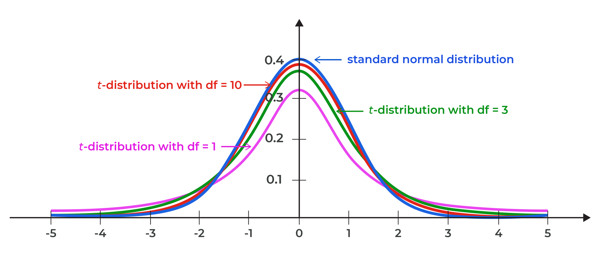
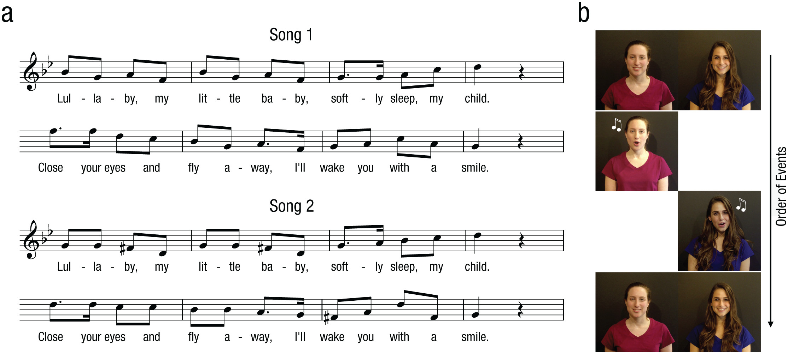



# Getting started

In this lab, we'll learn about the t-statistic and how it can be used to test a hypothesis, specifically using a one-sample t-test. Before starting this lab, make sure to have read **Chapter 7: t Tests: An Introduction to Comparing Two Things** from your textbook.

::: callout-note
## Learning objectives

By the end of this lab, you should be able to:

-   Understand the basic properties of the t distribution
-   Define what degrees of freedom are
-   Understand the differences between a z and t distribution
-   Use `R` to conduct and interpret the output of a one-sample t-test
-   Report the output of a one-sample t-test using APA formatting
:::

# Introducing the t-statistic

Up to this point, we've been using the z-test as our primary means of testing a hypothesis. However, it is almost never used in practice. Why is this? To understand this, let's take a quick review of the formula for calculating our z-statistic:

$$
z=\dfrac{M-\mu}{SE},\ where\  SE=\dfrac{\sigma}{\sqrt{n}}
$$

Taking a look at this, we can see that our z-test assumes that we know our population standard deviation, σ. However, we are almost always working with samples and as a result, we practically never know what the population standard deviation is.

What do we do in these situations? The most straightforward thing we can do here is to use the standard deviation of our sample to estimate the standard deviation of our population. If we were to use the sample standard deviation directly to calculate our test statistic, we would get a relatively close result but it would not be quite correct. This is because we are now introducing some uncertainty about what the true population standard deviation is. As we learned in our last lab, this is a problem because we want to minimize our likelihood of making erroneous conclusions from our hypothesis testing procedure.

## The t-distribution

Luckily for us, we can address this by using a slightly different distribution, called the **t-distribution**. Just like our standard normal distribution (i.e., the z-distribution), the t-distribution tells us the complete set of t-values calculated for every possible random sample of a given size.

One of the key differences is that our t-distribution is a family of distributions that differ based on the sample size. Specifically, we will have a different t-distribution for every number of **degrees of freedom (df)**. The degrees of freedom tells us the number of observations that are free to vary when estimating a parameter. Every time that we estimate a parameter in our population, we introduce a constraint onto our data. When estimating our population standard deviation, the associated calculation for degrees of freedom is $df=n-1$. However, note that there are different ways of calculating degrees of freedom depending on the situation.

The image below provides an illustration of how the t-distribution changes with different degrees of freedom. In addition, you can see how t-distributions compare to the standard normal distribution. To see the t-distribution at other degrees of freedom, you can also explore the demo here: <https://rpsychologist.com/d3/tdist/> How do these different distributions compare to one another? What changes? What stays the same?

{fig-alt="Illustration showing the standard normal distribution and different t-distributions at various degrees of freedom."}

# The one-sample t-test

Now that we know what the t-distribution is, how do we go about using it to test a hypothesis? Here, we'll be learning how to conduct our first type of t-test, a **one-sample t-test**. In a one-sample t-test, we are comparing our sample data to some known population mean value, μ. Oftentimes, this population mean value will not a mean itself, but some known value of interest for comparison. The formula for our one-sample t-test is below – this is pretty much identical to our formula for our z-statistic, except we are using our sample standard deviation to estimate our unknown population standard deviation:

$$
t=\dfrac{M-\mu}{SE},\ where\  SE=\dfrac{SD}{\sqrt{n}}
$$

Remember that null hypothesis significance testing (NHST) is not a single test, but a general procedure that we can follow. In other words, we'll be going through the same five steps of NHST that we had learned previously.

1.  State our hypotheses
2.  Create our decision rule
3.  Compute our observed test statistic
4.  Make a decision
5.  Report our results

# Does music convey social information to infants?

In this lab, we'll be using a one-sample t-test to analyze data from a study by Mehr, Song, & Spelke (2016).[^1] Parents often sing to their children and, even as infants, children listen to and look at their parents while they are singing. Here, the researchers sought to explore the psychological function that music has for parents and infants, by examining the hypothesis that particular melodies convey important social information to infants.

[^1]: The activity in this lab adapts and builds upon materials provided by Dr. Kevin P. McIntyre via [Open Stats Labs](https://sites.google.com/view/openstatslab/).

The authors argue that melodies are shared within social groups. Whereas children growing up in one culture may be exposed to certain songs as infants (e.g., “Rock-a-bye Baby”), children growing up in other cultures (or even other groups within a culture) may be exposed to different songs. Thus, when a novel person (someone who the infant has never seen before) sings a familiar song, it may signal to the infant that this new person is a member of their social group.

To test this hypothesis, the researchers recruited 32 infants and their parents to complete an experiment. During their first visit to the lab, the parents were taught a new lullaby (one that neither they nor their infants had heard before). The experimenters asked the parents to sing the new lullaby to their child every day for the next 1-2 weeks. Following this 1-2 week exposure period, the parents and their infant returned to the lab to complete the experimental portion of the study. Infants were first shown a screen with side-by-side videos of two unfamiliar people, each of whom were silently smiling and looking at the infant. The researchers recorded the looking behavior (or gaze) of the infants during this ‘**baseline**’ phase. Next, one by one, the two unfamiliar people on the screen sang either the lullaby that the parents learned or a different lullaby (that had the same lyrics and rhythm, but a different melody). Finally, the infants saw the same silent video used at baseline, and the researchers again recorded the looking behavior of the infants during this ‘**test**’ phase. For more details on the experiment’s methods, please refer to Mehr et al. (2016) Experiment 1.

{fig-alt="Study schematic of Mehr, Song, & Spelke (2016). Panel A depicts the sheet music for the novel lullabies. Panel B depicts the order of events, with infants first looking at two strangers next to one another. Afterwards, each individual would sing one of the two lullabies in turn, with the infant looking."}

## Exploring the data

Before starting to analyze the data, we will be drawing from some of the skills that we learned in the previous labs. The first thing that we will need to do is to load in the data for us to work with.

**Before we start, let's load in the packages that we'll need for this lab.**

```{webr}
# Download and load the tidyverse package (this might take a few moments)
install.packages("tidyverse", quiet = TRUE)
library(tidyverse)
```

**Let's use the `read.csv()` function to load in the data for us to use.**

```{webr}
# Use the read.csv() function to load in the dataset from Mehr, Song, & Spelke (2016)
data <- read.csv("data/lullabies.csv")

# Let's return the value from our data object by typing it's name 
data
```

There are quite a few variables to work with, but the columns that will be most relevant for us today are going to be `pref1` and `pref2`. These two columns indicate the proportion of gaze towards the singer of the familiar song at the baseline and test phases, respectively.

::: callout-caution
## Check your understanding

Let's imagine that singing the familiar song produces some attentional bias in the infants. If this is the case...

-   What should we expect the proportion of gaze to the singer of the familiar song at the **baseline** phase to be? At this point, both singers are unfamiliar to the infant, and they have not started yet sung anything.
-   What should we expect the proportion of gaze to the singer of the familiar song at the **test** phase to be? At this point, both singers have already sung their songs.
:::

## Visualizing the data

As a first pass, let's start working with the gaze preference at the baseline phase (i.e., `pref1`). When working with data, it is always helpful to first take a look at what it looks like. Let's first look at the distribution of scores for our `pref1` variables.

::: callout-caution
## Recap

Fill in the blanks in the code below to visualize the distribution of `pref1` scores. What type of graph should we use to visualize our distribution? As a hint, the function you use will be a `geom_*()` function, where the \* indicates a different type of plot.
:::

```{webr}
#| exercise: ex_1
# Use the code below to visualize the distribution of gaze proportion scores
data |>
  ggplot(aes(x = ______)) +
  ______(fill = "deepskyblue", bins = 7) +
  labs(x = "Gaze proportion to familiar singer",
       y = "Frequency") +
  theme_minimal()
```

## Describing the data

After taking a look at the data, let's next look at some of the descriptive statistics.

**Use the code below to find the mean and standard deviation of `pref1`** **scores. As a hint, we use the `$` symbol to access specific variables within our data.**

```{webr}
#| exercise: ex_2
# Use the code below to calculate descriptive statistics for the gaze proportion scores
mean(______)
sd(______)
```

After calculating these, take some time to interpret what these values are telling us. How do these compare the graph you made above? What do you expect the corresponding one-sample t-test to tell us if you were to make an educated guess?

## Conducting a one-sample t-test

Now, let's get to conducting our one-sample t-test. Since we are using `R`, the specifics will be slightly different, but we'll still be going through the five steps of the NHST procedure.

::: callout-tip
## Activity 1

Let's use our one-sample t-test to evaluate whether gaze preference to the singer of the familiar song (i.e., `pref1`) is different than what we would expect by chance. Use a two-tailed test with an α = .05.
:::

1.  In plain words, what are the statistical hypotheses? What are the null and alternative hypotheses?

2.  The next step that we usually undergo in our NHST procedure is to find the critical values. Here, we would look up the corresponding critical value in a table by hand and compare our calculated test statistic to the critical values. When computing a statistical test using software, we can usually jump to producing the *p*-value corresponding to our test statistic. In this case, what we are essentially doing is comparing our calculated *p-*value to the α level directly. In both cases, the underlying logic is the same – we set our criteria for determining significance and compare our calculated value to that.

::: callout-caution
## Recap

**What does the *p-*value tell us?**

```{ojs}
//| echo: false 
viewof userChoice = Inputs.radio(   
  [
  "The p-value tells us the probability that the null hypothesis is true.", 
  "The p-value tells us the probability that the alternative hypothesis is true.",
  "The p-value tells us the probability that the observed (or more extreme) results occurred by chance.",
  "The p-value tell us the probability of obtaining the observed (or more extreme) results, given the null hypothesis is true.",
  "The p-value tell us the probability of obtaining the observed (or more extreme) results, given the alternative hypothesis is true.",
  ],    
  {     
    label: null,     
    value: null   
  } 
);
```

```{ojs}
//| echo: false 
{   
  if (userChoice === null) {     
    return html`<em>Please select an answer above.</em>`;   
    
  } else if (userChoice === "The p-value tell us the probability of obtaining the observed (or more extreme) results, given the null hypothesis is true.") {     
    return html`<div style="color: green; font-weight: bold;"> Correct!</div>`;   
  } else {
    return html`<div style="color: red;"> Try again!</div>`;   
  } 
}
```
:::

3.  Next, we'll be using a function called `t.test()` to conduct our one-sample t-test. The formula for our one-sample t-test is:

    $$
    t=\dfrac{M-\mu}{SE},\ where\  SE=\dfrac{SD}{\sqrt{n}}
    $$

    To conduct a one-sample t-test using the `t.test()` function, we will specify a few different parameters:

    -   The first parameter will be the data column that we are working with. In this case, we will use the `pref1` scores from our `data` object.

    -   The second parameter is `mu`, which is the population value that we want to compare to.

    -   The last parameter is `alternative`, which tells us what type of alternative test we want to use. This can be either "two.sided", "less", or "greater". By default, this will be set to "two.sided", meaning a two-tailed hypothesis test.

    **Fill in the code block below to conduct a one-sample t-test on our `pref1`** **data. As a hint, we use the `$` symbol to access specific variables within our data.**

    ```{webr}
    #| exercise: ex_3
    # Use the code below to conduct a one-sample t-test for the gaze proportion scores
    t.test(______, mu = ______, alternative = ______)
    ```

4.  Based on these results, will you reject or fail to reject the null hypothesis? How does your observed test statistic compare to your decision criteria? Would you consider your results statistically significant? In plain words, how would you describe the results of your analyses?

## Effect sizes

In addition to the statistical significance, it is always helpful to calculate a measure of effect size to get a sense of the practical significance of the effect. For a one-sample t-test, we can use the same measure of effect size that we had used previously, the **Cohen's *d***. Although we do not know our population standard deviation, σ, we can still use the same formula and interpretation with our sample standard deviation instead.

$$
d=\dfrac{M-\mu}{SD}
$$

Previously, we calculated Cohen's *d* using the formula. This time, we'll be using the `effectsize` package to help do this for us.

**Let's first install and load in the `effectsize`** **package.**

```{webr}
# Download and load the effectsize package (this might take a few moments)
install.packages("effectsize", quiet = TRUE)
library(effectsize)
```

Now that we have loaded in the `effectsize` package, we can use a function called `cohens_d()`. The syntax for this formula is quite similar to the one we just used for the `t.test()` function. We first provide the data column that we are working with, followed by the `mu` that we are comparing to – we do not need to provide an `alternative` parameter.

**Fill in the code block below to find the Cohen's *d* for our `pref1`** **data.**

```{webr}
#| exercise: ex_4
# Use the code below to conduct a one-sample t-test for the gaze proportion scores
cohens_d(______, mu = ______)
```

How should we interpret this Cohen's *d* value? What does this tell us about the practical significance of our result?

## Confidence intervals

One other thing that you might have noticed is that the output our `t.test()` above also produces a **confidence interval**. This gives us an interval that is likely to contain the population mean, μ, with an associated level of confidence. Previously, we calculated our confidence interval by using the corresponding critical z-value:
$$
CI=M \pm z_{crit}\times SE,\ where\  SE=\dfrac{\sigma}{\sqrt{n}}
$$

Notice here that we do not have our population standard deviation, σ. What we'll do instead is estimate this using our sample standard deviation. Similarly, we will sub out our critical z-value with our critical t-value instead:

$$
CI=M \pm t_{crit}\times SE,\ where\  SE=\dfrac{SD}{\sqrt{n}}
$$

This confidence interval is interpreted in the exact same way as we had done previously. By default, the `t.test()` function will calculate a 95% confidence interval, but we can adjust our level of confidence by adjusting the `conf.level` parameter in our `t.test()` function.

**Use the code block below to see what happens to our confidence interval when we change the associated confidence level to 99%.**

```{webr}
#| exercise: ex_5
# Use the code below to conduct a one-sample t-test for the gaze proportion scores
t.test(______, mu = ______, alternative = ______, conf.level = 0.99)
```

## Reporting our results

The last important step in our NHST procedure is to actually report our results. To do so, we'll be using the guidelines provided by the *American Psychological Association* (i.e., **APA style/format**), just like we had done previously when reporting our descriptive statistics. A few elements we need to include reporting our results are:

-   What statistical test we used
-   Descriptive statistics for our data (e.g., mean, standard deviation, confidence interval)
-   The calculated test statistic (*t*), degrees of freedom (*df*), and *p*-value
-   The effect size (*d*) and interpretation.
-   If our findings are significant, we also want to report the direction of this difference (e.g., which group was bigger or smaller?)

Oftentimes, the calculated test statistic, degrees of freedom, *p*-value, and effect size are reported together at the end of the sentence, with values reported to two or three decimal places. As an example, we could report the findings of our analysis like:

> "A one-sample t-test was used to determine whether the the proportion of gaze to the singer of the familiar song at the baseline phase differed from that expected by chance (0.5). There was no significant difference in the proportion of time spent looking at the person singing the familiar song at baseline (M = 0.52, SD = 0.18, 95% CI \[0.46, 0.58\]) from chance, *t*(31) = 0.67, *p* = 0.51, *d* = 0.12. This was a very small effect."

::: callout-tip
## Activity 2

In the above analysis, we found that the proportion of gaze to the singer of the familiar song at the **baseline** phase did not differ from what we would expect by chance. However, there was also a second **test** phase where the researchers measured the proportion of gaze after each singer sang a familiar or unfamiliar song. This data can be found in the `pref2` column. Adapt the code above to use the one-sample t-test to see whether we seen any differences after the singers sang their song. Use a two-tailed test with an α = .05. Calculate the associated effect size and a 95% confidence interval. Make sure to report your findings using APA style.
:::

# That's all for now, great work!

**Use what you have learned to answer some questions about this lab in the corresponding Assignment on CourseLink!**

## References

Mehr, S. A., Song, L. A., & Spelke, E. S. (2016). For 5-month-old infants, melodies are social. *Psychological Science*, *27*(4), 486-501. <https://doi.org/10.1177/0956797615626691>
