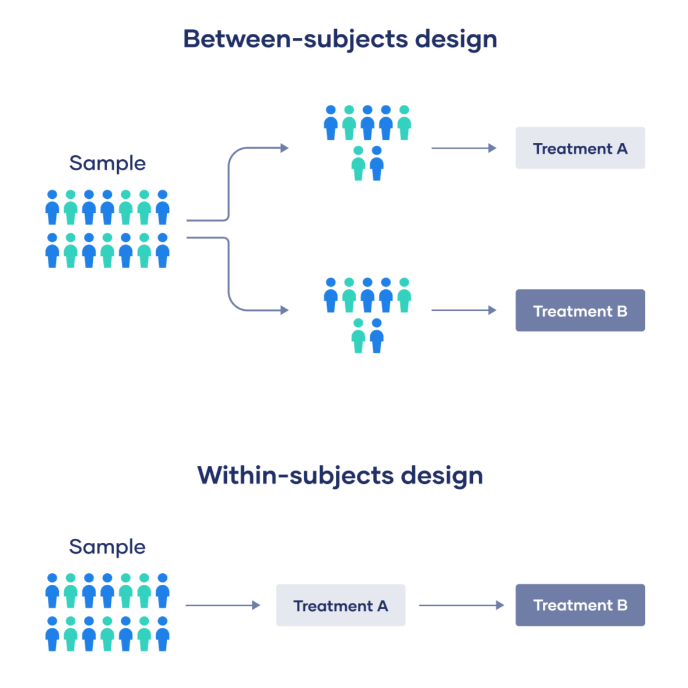
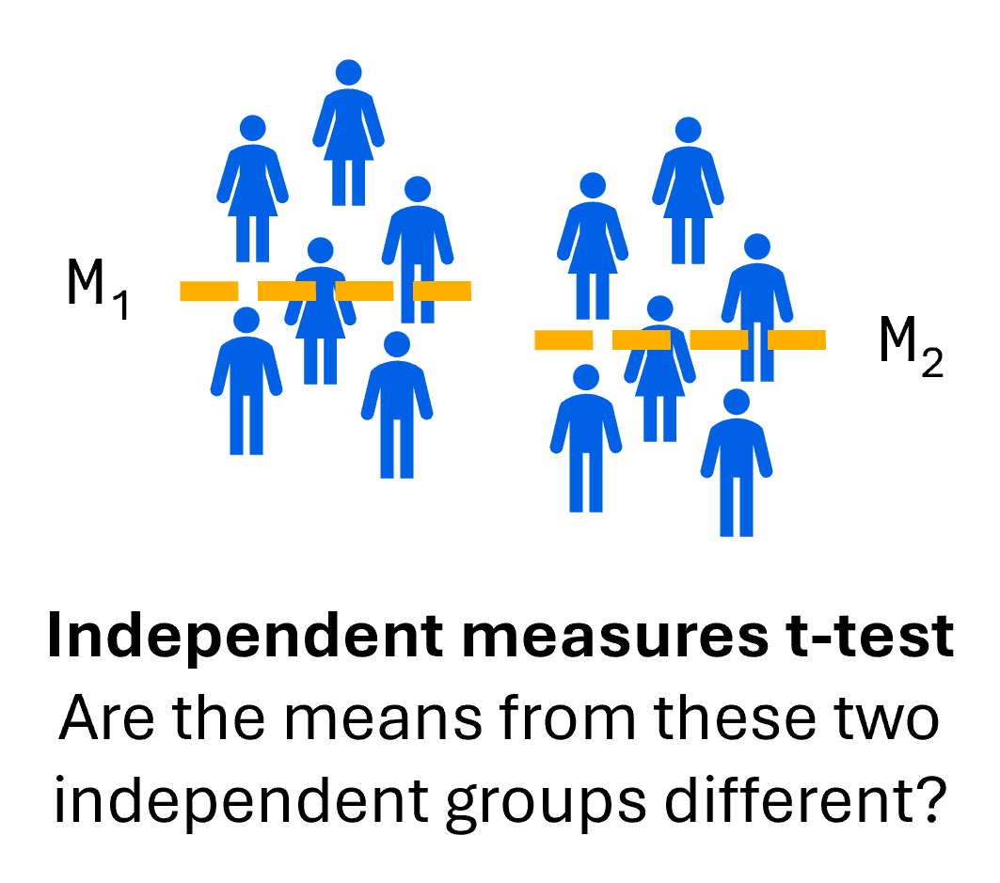
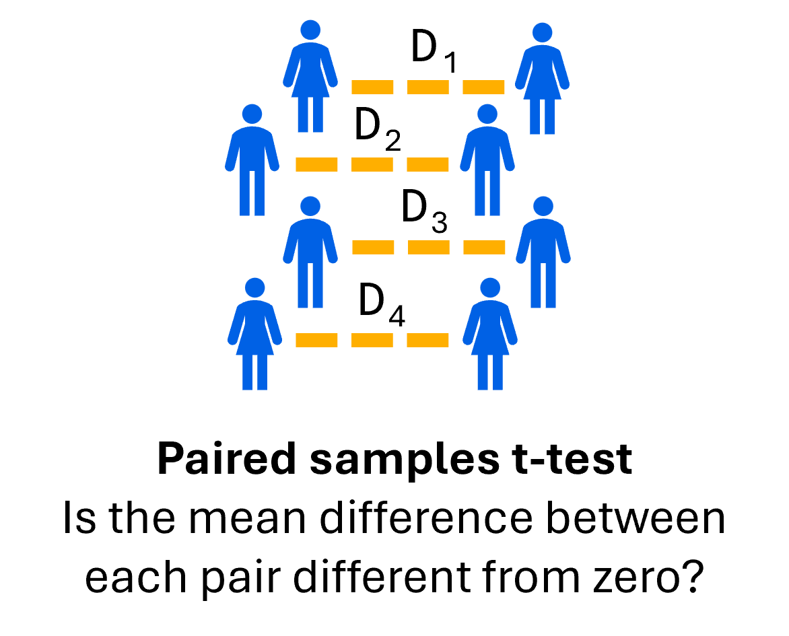
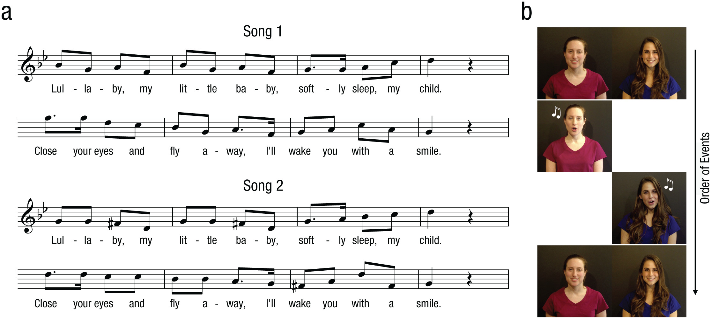



# Getting started

In this lab, we'll build upon the t-statistic and one-sample t-test we learned last week, specifically with the independent measures and paired t-tests. Before starting this lab, make sure to have read **Chapter 8: More t Tests: Independent and Paired-Sample t Tests** from your textbook.

::: callout-note
## Learning objectives

By the end of this lab, you should be able to:

-   Identify the difference between a between-samples and within-samples research design
-   Identify situations in which it is appropriate to use the different types of t-tests (i.e., one-sample, independent measures, paired samples)
-   Use `R` to conduct and interpret the output of an independent measures t-test
-   Report the output of a independent measures t-test using APA formatting
-   Use `R` to conduct and interpret the output of a paired samples t-test
-   Report the output of a paired samples t-test using APA formatting
:::

Last week, we how to use the **one-sample t-test** to compare our sample data to some population mean value, μ (oftentimes some value of interest for comparison). Although it has its uses, it is not the most typical example of a t-test because we oftentimes do not have a known value to compare to in psychology research. Instead, we will usually be comparing two different groups of observations, with each group corresponding to a different level of your independent variable. As a result, we will also be using different types of t-tests to test our hypotheses. To determine which type of t-test is most appropriate, we will first need to learn to identify the type of research design being used.

# Between vs. Within Subjects Designs

When comparing two different groups, there are two general types of research designs we can use:

1.  In a **between-subjects** (or independent measures) research design, each participant only contributes data to **one level** of your independent variable. Participants in each group are **statistically independent** from one another.
2.  In a **within-subjects** (or repeated measures or dependent measures or paired samples), each participant contributes data to **all levels** of your independent variable. Here, participants in each group are **statistically dependent.**

{fig-alt="Schematic depicting the difference between a between and within subjects research design."}

Determining the research design being used in a given scenario is imperative to ensure that a given statistical test is being used appropriately. It is helpful to get in the habit of identifying a few key features when coming across a research scenario – here, you can ask yourself the following questions:

-   What is the independent variable? What are the levels of the independent variable?
-   What is the dependent variable?
-   Is this a between- or within-subjects design?

::: callout-caution
## Check your understanding

Let's get some practice with some different research scenarios! For each of the following, identify (1) the independent variable, and the levels of the independent variable, (2) the dependent variable, and (3) whether a between- or within-subjects design is being used.

-   You want to assess the effects of caffeine on fine motor control. You recruit participants to the lab and ask them to play a game of Operation. You record their errors. You then ask them to drink a shot of espresso. Thirty minutes later you ask them to replay Operation, again recording their errors.
-   You are investigating the effects of smell on test performance. Half of the participants are randomly assigned to take a math test in a lavender scented room. The other half of participants are assigned to take the same test in an identical room that is cinnamon scented.
-   You want to see if people rate men or women as more trustworthy. You show participants images of men and women accompanied by different statements. Following each image participants rate the person’s trustworthiness. All participants view images of both men and women.
:::

# The independent measures t-test

When we are comparing two groups in a between-subjects research design, we will use an **independent measures t-test**. In an independent measures t-test, we are comparing across two samples to determine whether their corresponding populations are different from one another. The formula for calculating our independent measures t-test is:

$$
t=\dfrac{M_1-M_2}{s_{M_1-M_2}}
$$

Note that we are now comparing two sample means (i.e., $M_1$ and $M_2$) rather than one sample in our z-test or one-sample t-test. In the denominator, we see a new term which refers to the **standard error of the difference** (i.e., $s_{M_1-M_2}$). The standard error of the difference tells us the average difference we should expect to see between our sample means, given the null hypothesis is true. Conceptually, this is the same idea as the standard error that we had learned for our one-sample t-test.



Just like with our one-sample t-test, our independent measures t-test follows the same null hypothesis significance testing (NHST) procedure that we had learned previously:

1.  State our hypotheses
2.  Create our decision rule
3.  Compute our observed test statistic
4.  Make a decision
5.  Report our results

# Do spoken or written words better express intelligence?

In the first part of this lab, we'll be using an independent measures t-test to analyze data from a study by Schroeder & Epley (2015).[^1] Imagine you were a job candidate trying to pitch your skills to a potential employer. Would you be more likely to get the job after giving a short speech describing your skills, or after writing a short speech and having a potential employer read those words? Here, the researchers predicted that a person’s speech (i.e., vocal tone, cadence, and pitch) communicates information about their intellect better than their written words (even if they are the same words as in the speech).

[^1]: The activity in this lab adapts and builds upon materials provided by Dr. Kevin P. McIntyre via [Open Stats Labs](https://sites.google.com/view/openstatslab/).

To examine this possibility, the authors randomly assigned 39 professional recruiters for Fortune 500 companies to one of two conditions. In the **audio** condition, participants listened to audio recordings of a job candidate’s spoken job pitch. In the **transcript** condition, participants read a transcription of the job candidate’s pitch. After hearing or reading the pitch, the participants rated the job candidates on three dimensions: intelligence, competence, and thoughtfulness. These ratings were then averaged to create a single measure of the job candidate’s intellect, with higher scores indicating the recruiters rated the candidates as higher in intellect. The participants also rated their overall impression of the job candidate (a composite of two items measuring positive and negative impressions). Finally, the participants indicated how likely they would be to recommend hiring the job candidate (0 - not at all likely, 10 - extremely likely). For more details on the experiment’s methods, please refer to Schroeder & Epley (2016) Experiment 4.

::: callout-caution
## Check your understanding

Based on this research design, what is the independent variable? What are the levels of the independent variable? What is the dependent variable? Is this a between- or within-subjects design? Note that in this study, there are multiple dependent variables.
:::

## Exploring the data

As always, it is extremely helpful to first look and explore the data that you are looking at!

**Before we start, let's load in the packages that we'll need for this lab.**

```{webr}
# Download and load the tidyverse package (this might take a few moments) 
install.packages("tidyverse", quiet = TRUE) 
library(tidyverse)
```

**Let's use the `read.csv()` function to load in the data for us to use.**

```{webr}
# Use the read.csv() function to load in the dataset from Schroeder & Epley (2015)
intellect_data <- read.csv("data/intellect-sound.csv")  

# Let's return the value from our intellect_data object by typing its name  
intellect_data
```

Here, our `Condition` column refers to the two different conditions in the study. In this study, there are a few dependent variables being compared, so we will compare scores in the `Intellect_Rating`, which corresponds to the rating that recruiters gave a candidate after seeing the transcript or audio recording of their interview (on a scale from 1 to 10).

To start out with, let's calculate some descriptive statistics to compare `Intellect_Rating`, grouped by our different conditions. In addition to the mean and standard deviation, we will also calculate the **standard error**, which gives us an idea for how precise our sample mean is. The formula for calculating our standard error is $SE=\dfrac{SD}{\sqrt{n}}$.

**Let's use the code below to calculate our mean, standard deviation, and standard error for our `Intellect_Rating` scores across the different levels in our `Condition` column. Don't worry about understanding the nuts and bolts of the code, though you should be able to interpret what these values are telling you!**

```{webr}
# Use the code below to calculate descriptive statistics for the intellect ratings across conditions
intellect_descriptives <- intellect_data |>
  group_by(Condition) |>
  summarise(mean = mean(Intellect_Rating),
            sd = sd(Intellect_Rating),
            se = sd(Intellect_Rating) / sqrt(length(Intellect_Rating)))
            
# Let's take a look at our descriptive statistics
intellect_descriptives            
```

Beyond seeing these descriptive statistics themselves, it is also helpful to visualize these. Since we are comparing values across two conditions, we could visualize this using a bar graph, with error bars depicting our standard errors.

**Let's use the code below to create a bar graph to compare `Intellect_Rating`** **scores across the different levels in our `Condition`** **column. Don't worry about understanding the nuts and bolts of the code.**

```{webr}
# Use the code below to visualize the intellect ratings across conditions as a bar graph
intellect_descriptives |>
  ggplot(aes(x = Condition, y = mean)) +
  geom_bar(stat="identity", aes(fill = Condition)) + 
  geom_errorbar(aes(ymin = mean - se, ymax = mean + se), width = 0.1) +
  labs(x = "Experimental Condition",
       y = "Frequency") +
  scale_fill_grey() +
  theme_minimal()
```

As a starting off point, this plot gives us a helpful check to make sure that our data are behaving sensibly. For example, we know that our responses must be between 1 and 10, so if we found numbers outside this range, we would know that something was wrong.

In addition, this plot gives us an idea for the patterns in the data, which should help you form an intuition for how the resulting hypothesis test will turn out. How do the means compare to one another? What do the error bars tell us? Do we expect to see a big t-statistic or a small t-statistic? Do we expect to see a big p-value or a small p-value?

## Conducting an independent measures t-test

Now, let's go through the five steps of the NHST procedure using the independent measures t-test.

::: callout-tip
## Activity 1

Let's use our independent measures t-test to evaluate whether intellect ratings of candidates (i.e., `Intellect_Rating`) differ depending on whether recruiters are given a transcript or audio recording of an interview (i.e., `Condition`). Use a two-tailed test with an α = .05.
:::

1.  In plain words, what are the statistical hypotheses? What are the null and alternative hypotheses?

2.  The next step that we usually undergo in our NHST procedure is to find the critical values. Since we are computing this using `R`, we can compare our calculated *p-*value to the α level directly. As a reminder, our α Ievel sets our criteria for determining whether a difference is statistically significant.

3.  To conduct our independent measures t-test, we'll be using the `t.test()` function that we had used for our one-sample t-test. However, the syntax will look a little different than what we used previously. Specifically, we will compare our groups using this format: *dv* \~ *iv*, where *dv* is the name of your dependent variable and *iv* is the name of your independent variable. In addition, we will also set a parameter `var.equal = TRUE` to work under the assumption that our variances are equal to one another[^2]. Similar to the one-sample t-test, we can specify an `alternative` parameter, which tells us what type of alternative test we want to use. This can be either "two.sided", "less", or "greater". By default, this will be set to "two.sided", meaning a two-tailed hypothesis test. Do not worry if the syntax is a bit confusing, the main focus is on interpreting the resulting output.

    **Use the code below to conduct an independent measures t-test comparing `Intellect_Rating`** **scores across the transcript and audio conditions. As a reminder, we use the `$` symbol to access specific variables within our data.**

    ```{webr}
    # Use the code below to compare intellect ratings across conditions using an independent measures t-test
    t.test(intellect_data$Intellect_Rating ~ intellect_data$Condition, var.equal = TRUE, alternative = "two.sided")
    ```

4.  Based on these results, will you reject or fail to reject the null hypothesis? How does your observed test statistic compare to your decision criteria? Would you consider your results statistically significant? In plain words, how would you describe the results of your analyses?

[^2]: By setting this, we are conducting what is called a **Student t-test**, which works under the assumption that both of our samples have the same variance. If we do not set this, we will be conducting a slightly different type of t-test called the **Welch t-test**. For the purposes of this course, we will only be working with the Student t-test, but the underlying logic for the Welch t-test is the same, only with a slightly different standard error calculation that does not assume that the samples have the same variance.

## Effect sizes and confidence intervals

Just like with our other hypothesis tests, we will also calculate the corresponding effect size and confidence intervals to provide additional information about our data. Similarly to our one-sample t-test, our measure of effect size here will be **Cohen's d**, which measures the size of a difference in terms of the standard deviation. We'll be using the `effectsize` package again to help do this for us.

**Let's first install and load in the `effectsize`** **package.**

```{webr}
# Download and load the effectsize package (this might take a few moments) 
install.packages("effectsize", quiet = TRUE) 
library(effectsize)
```

We will again be using the `cohens_d()` function to calculate Cohen's d. For an independent measures t-test, we can use the same *dv* \~ *iv* format that we used earlier, where *dv* is the name of your dependent variable and *iv* is the name of your independent variable.

**Use the code below to find the Cohen's *d* for the difference in intellect ratings across conditions.**

```{webr}
# Use the code below to find the Cohen's d for the difference in intellect ratings across conditions
cohens_d(intellect_data$Intellect_Rating ~ intellect_data$Condition)
```

How should we interpret this Cohen's *d* value? What does this tell us about the practical significance of our result?

In terms of confidence intervals, the `t.test()` function will calculate a 95% confidence interval by default. Like with our one-sample t-test, we can adjust our level of confidence by adjusting the `conf.level` parameter in our `t.test()` function.

## Reporting our results

Lastly, we need to report the results from our analyses using APA formatting. As a general format, we will need to include the following elements when reporting our results:

-   What statistical test we used
-   Descriptive statistics for our data (e.g., mean, standard deviation, confidence interval)
-   The calculated test statistic (*t*), degrees of freedom (*df*), and *p*-value
-   The effect size (*d*) and interpretation.
-   If our findings are significant, we also want to report the direction of this difference (e.g., which group was bigger or smaller?)

As an example, we could report the findings of our analysis like:

> "An independent measures t-test was used to compare intellect ratings of candidates after recruiters were given either a transcript or audio recording of their interview. Candidates were rated as having significantly greater intellect after hearing their interview (M = 5.63, SD = 1.61) than after reading a transcript of their interview (M = 3.65, SD = 1.91), *t*(37) = 3.53, *p* = .0011, 95% CI \[0.85, 3.13\], *d* = 1.13. This was a large effect."

# The paired samples t-test

What do we do if we are comparing two groups using a within-subjects research design? In this case, our data are no longer statistically independent since the data from the two groups we are comparing are coming from the same set of people and consequently, we cannot use the independent measures t-test. In this case, we will use our third type of t-test, a **paired samples t-test**, which allows us to determine whether two related sets of data. Let's take a quick look at the formula for calculating our paired samples t-test:

$$
t=\dfrac{M_D}{s_{M_D}},\ where \ s_{M_D}=\dfrac{s_D}{\sqrt{n}}
$$

One thing you may notice is that the paired samples t-test references a new term, $D$, which represents the difference between a pair of scores. In a within-subjects design, this may look like the difference across time points (e.g., before and after some treatment) or across conditions (e.g., in an experimental task). Although the formula looks like a little different, the underlying concept across all of our t-tests are the same. In the numerator, we are looking at the average mean difference (i.e., $M_D$) and comparing this to the **standard error of the mean difference** (i.e., $s_{M_D}$), which tells us the average mean difference we should expect given the null hypothesis is true. Effectively, the paired samples t-test is a one-sample t-test applied to the difference between two groups (i.e., is the average mean difference different than 0?)



You have probably guessed this already, but our paired samples t-test also follows the same null hypothesis significance testing (NHST) procedure that we had learned previously:

1.  State our hypotheses
2.  Create our decision rule
3.  Compute our observed test statistic
4.  Make a decision
5.  Report our results

# Does music convey social information to infants?

To see the paired samples t-test in action, we will return to the dataset we used last week from Mehr, Song, & Spelke (2016).[^3] As a brief reminder, the researchers here were interested in exploring the psychological function that music has for parents and infants.

[^3]: The activity in this lab also adapts and builds upon materials provided by Dr. Kevin P. McIntyre via [Open Stats Labs](https://sites.google.com/view/openstatslab/).

They recruited 32 infants and their parents to complete an experiment. During their first visit to the lab, the parents were taught a new lullaby (one that neither they nor their infants had heard before). The experimenters asked the parents to sing the new lullaby to their child every day for the next 1-2 weeks. Following this 1-2 week exposure period, the parents and their infant returned to the lab to complete the experimental portion of the study. Infants were first shown a screen with side-by-side videos of two unfamiliar people, each of whom were silently smiling and looking at the infant. The researchers recorded the looking behavior (or gaze) of the infants during this ‘**baseline**’ phase. Next, one by one, the two unfamiliar people on the screen sang either the lullaby that the parents learned or a different lullaby (that had the same lyrics and rhythm, but a different melody). Finally, the infants saw the same silent video used at baseline, and the researchers again recorded the looking behavior of the infants during this ‘**test**’ phase. For more details on the experiment’s methods, please refer to Mehr et al. (2016) Experiment 1.

{fig-alt="Study schematic of Mehr, Song, & Spelke (2016). Panel A depicts the sheet music for the novel lullabies. Panel B depicts the order of events, with infants first looking at two strangers next to one another. Afterwards, each individual would sing one of the two lullabies in turn, with the infant looking."}

::: callout-caution
## Check your understanding

Based on this research design, what is the independent variable? What are the levels of the independent variable? What is the dependent variable? Is this a between- or within-subjects design? Note that in this study, there are multiple dependent variables.
:::

## Exploring the data

Last time when we were working with this dataset, we used one-sample t-tests to test whether gaze preference to the singer of the familiar song is different than what we would expect by chance at baseline (i.e., before singing) and test (i.e., after singing). Here, we can also directly compare to see whether gaze preferences differ across these two conditions using our paired samples t-test.

**Let's use the `read.csv()` function to load in the data for us to use.**

```{webr}
# Use the read.csv() function to load in the dataset from Mehr, Song, & Spelke (2016)
lullabies_data <- read.csv("data/lullabies.csv")

# Let's return the value from our lullabies_data object by typing its name 
lullabies_data
```

As a reminder, the `pref1` column indicates the proportion of gaze towards the singer of the familiar song at the baseline phase, and the `pref2` column indicates the proportion of gaze towards the singer of the familiar song at the test phase.

Let's start by calculating the descriptive statistics for these, as we had done previously. Similarly to above, we can also calculate the standard error, $SE=\dfrac{SD}{\sqrt{n}}$.

**Let's use the code below to calculate our mean, standard deviation, and standard error for the gaze preference scores across the baseline and test phases. Don't worry about understanding the nuts and bolts of the code, though you should be able to interpret what these values are telling you!**

```{webr}
# Use the code below to calculate descriptive statistics for the gaze preference scores across conditions 
lullabies_descriptives <- lullabies_data |>
  rename(Baseline = pref1,
         Test = pref2) |>
  pivot_longer(cols = c(Baseline, Test),
               names_to = "Condition",
               values_to = "pref") |>
  group_by(Condition) |>   
  summarise(mean = mean(pref),             
            sd = sd(pref),             
            se = sd(pref) / sqrt(length(pref)))              

# Let's take a look at our descriptive statistics 
lullabies_descriptives            
```

In our last lab, we visualized each of the preference score distributions using histograms. This time, let's visualize these data using a bar graph to look at how preference scores differ across the baseline and test conditions, with error bars depicting our standard errors.

**Let's use the code below to create a bar graph to compare the gaze preference scores across the baseline and test phases. Don't worry about understanding the nuts and bolts of the code.**

```{webr}
# Use the code below to visualize the gaze preference scores across conditions as a bar graph 
lullabies_descriptives |>   
  ggplot(aes(x = Condition, y = mean)) +   
  geom_bar(stat="identity", aes(fill = Condition)) +    
  geom_errorbar(aes(ymin = mean - se, ymax = mean + se), width = 0.1) +   
  labs(x = "Experimental Condition",        
       y = "Proportion of Time Looking Towards Familiar Singer") +   
  scale_fill_grey() +   
  theme_minimal()
```

Just like before, this graph should help you form your intuition for how the resulting hypothesis test will turn out. How do the means compare to one another? What do the error bars tell us? Do we expect to see a big t-statistic or a small t-statistic? Do we expect to see a big p-value or a small p-value?

## Conducting a paired samples t-test

Now, let's go through the five steps of the NHST procedure using the paired samples t-test.

::: callout-tip
## Activity 2

Let's use our paired samples t-test to evaluate whether gaze preference to the singer of the familiar song differ the baseline and test phases. In other words, we are comparing preference scores before singing (i.e., `pref1`) and after singing (i.e., `pref2`). Use a two-tailed test with an α = .05.
:::

1.  In plain words, what are the statistical hypotheses? What are the null and alternative hypotheses?

2.  The next step that we usually undergo in our NHST procedure is to find the critical values. Since we are computing this using `R`, we can compare our calculated *p-*value to the α level directly. As a reminder, our α Ievel sets our criteria for determining whether a difference is statistically significant.

3.  To conduct our paired samples t-test, we'll be using the `t.test()` function again. Just like before, the syntax will differ a bit. For a paired t-test, we specify the two sets of data we want to compare as our first two parameters, in addition to setting `paired=TRUE` to indicate that these two sets of data are paired. Similarly to our independent measures t-test, we will also set a parameter `var.equal = TRUE`. We can also specify an `alternative` parameter, which tells us what type of alternative test we want to use. This can be either "two.sided", "less", or "greater". By default, this will be set to "two.sided", meaning a two-tailed hypothesis test. Again, do not worry if the syntax is a bit confusing, the main focus is on interpreting the resulting output.

    **Use the code below to conduct a paired samples t-test comparing gaze preference** **to the singer of the familiar song at baseline (i.e., `pref1`) and test (i.e., `pref2`). As a reminder, we use the `$` symbol to access specific variables within our data.**

    ```{webr}
    # Use the code below to compare gaze preference scores across conditions using a paired samples t-test 
    t.test(lullabies_data$pref1, lullabies_data$pref2, paired = TRUE, var.equal = TRUE, alternative = "two.sided")
    ```

4.  Based on these results, will you reject or fail to reject the null hypothesis? How does your observed test statistic compare to your decision criteria? Would you consider your results statistically significant? In plain words, how would you describe the results of your analyses?

## Effect sizes and confidence intervals

Like with our independent measures t-test, our measure of effect size for the paired samples t-test will be **Cohen's d**, which measures the size of a difference in terms of the standard deviation. We'll be using the `effectsize` package again to help do this for us. We will again be using the `cohens_d()` function to calculate Cohen's d. For a paired samples t-test, the syntax will be similar to the one we used with our `t.test()` function – we specify the two sets of data we want to compare as our first two parameters, in addition to setting `paired=TRUE` to indicate that these two sets of data are paired.

**Use the code below to find the Cohen's *d* for the difference in intellect ratings across conditions.**

```{webr}
# Use the code below to find the Cohen's d for the difference in gaze preference scores across conditions 
cohens_d(lullabies_data$pref1, lullabies_data$pref2, paired = TRUE)
```

How should we interpret this Cohen's *d* value? What does this tell us about the practical significance of our result?

In terms of confidence intervals, the `t.test()` function will calculate a 95% confidence interval by default. Like with our one-sample t-test, we can adjust our level of confidence by adjusting the `conf.level` parameter in our `t.test()` function.

## Reporting our results

The final step is to report the results from our analyses using APA formatting. As a reminder, we will need to include the following elements when reporting our results:

-   What statistical test we used
-   Descriptive statistics for our data (e.g., mean, standard deviation, confidence interval)
-   The calculated test statistic (*t*), degrees of freedom (*df*), and *p*-value
-   The effect size (*d*) and interpretation.
-   If our findings are significant, we also want to report the direction of this difference (e.g., which group was bigger or smaller?)

As an example, we could report the findings of our analysis like:

> "A paired samples t-test was used to compare gaze preference to the singer of the familiar song differ the baseline and test phases. Infants spent a longer time looking at the singer of the familiar song after they had sung the familiar song (M = 0.593, S = 0.179) than before (M = 0.521, SD = 0.177), *t*(31) = -2.42, *p* = 0.022, 95% CI \[-0.133. -0.011\], *d* = 0.43. This was a small effect."

# That's all for now, great work!

**Use what you have learned to answer some questions about this lab in the corresponding Assignment on CourseLink!**

## References

Mehr, S. A., Song, L. A., & Spelke, E. S. (2016). For 5-month-old infants, melodies are social. *Psychological Science*, *27*(4), 486-501. <https://doi.org/10.1177/0956797615626691>

Schroeder, J., & Epley, N. (2015). The sound of intellect: Speech reveals a thoughtful mind, increasing a job candidate’s appeal. *Psychological Science, 26*(6), 877-891. <https://doi.org/10.1177/0956797615572906>
