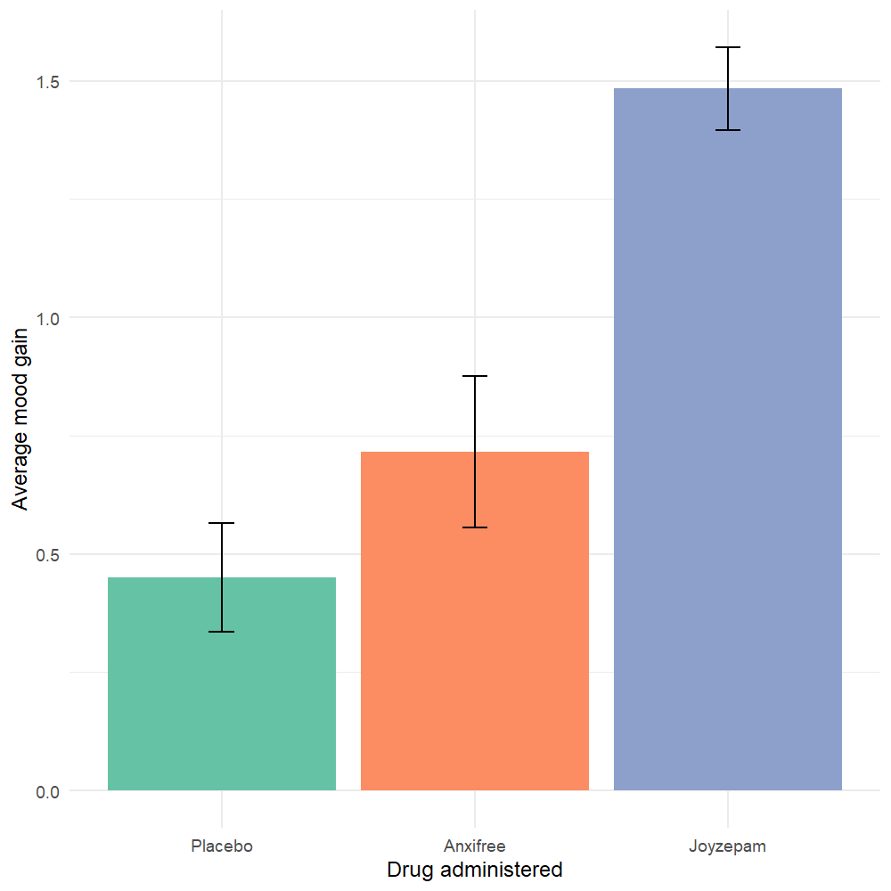
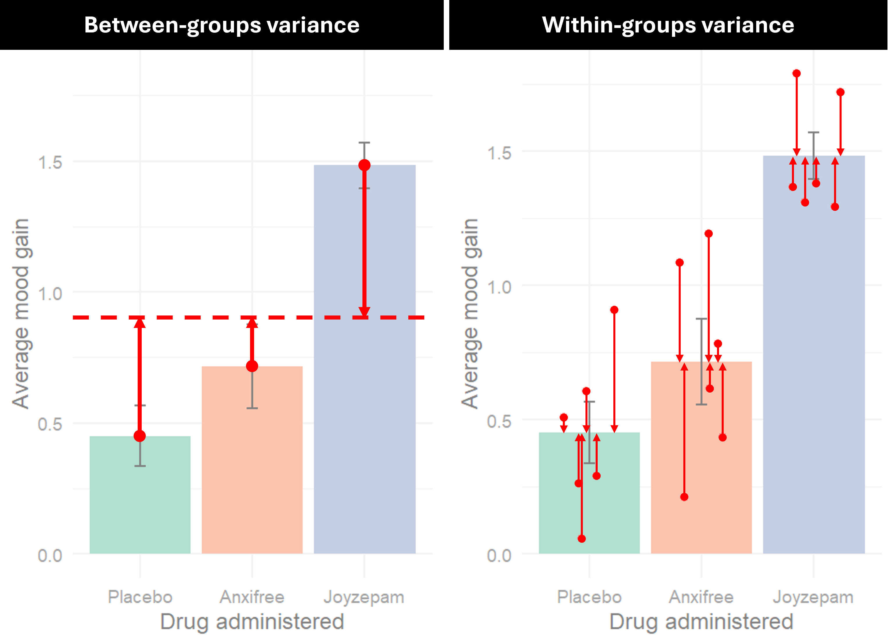
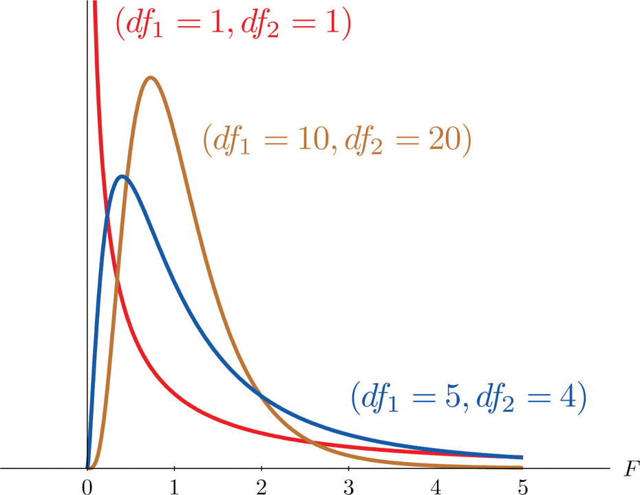



# Getting started

In this lab, we'll learn about a frequently used tool in statistics called the analysis of variance, or ANOVA. More specifically, we will be learning about the independent measures one-way ANOVA. Before starting this lab, make sure to have read **Chapter 9: ANOVA: Comparing More Than Two Conditions** from your textbook – you are only responsible for sections 9.1 to 9.10.

::: callout-note
## Learning objectives

By the end of this lab, you should be able to:

-   Describe the logic underlying an analysis of variance
-   Distinguish between within-group and between-group variance
-   Identify situations in which it is appropriate to use an independent measure one-way ANOVA
-   Use `R` to conduct and interpret the output of an independent measures one-way ANOVA, including effect sizes and post-hoc comparisons
-   Report the output of an independent measures one-way ANOVA APA using formatting
:::

So far, we've learned about different tests that allow us to compare two values, whether that is a single sample to a known population value (i.e., z-test or one-sample t-test) or two samples to one another (i.e., independent measures t-test or paired samples t-test). Although the name of the technique refers to variances, an **analysis of variance (ANOVA)** grants us the ability to compare more than two values.

# Logic behind the ANOVA

To illustrate the logic behind an ANOVA, let's imagine a scenario[^1] where you are testing a new antidepressant drug called *Joyzepam*. To fairly evaluate the effectiveness of this new drug, you compare it to both a placebo and *Anxifree*, an existing antidepressant drug. You recruit a group of 18 participants with moderate to severe depression and randomly assign them to take one of the three drugs, and after 3 months, a psychologist assesses the change in mood on a scale from -5 to 5. To visualize your data, you create a bar graph, with error bars depicting the standard errors:

[^1]: This scenario is drawn from materials by Dr. Danielle Navarro via her [Learning Statistics with R](https://learningstatisticswithr.com/) textbook.

{fig-alt="Bar chart showing the results of a fictional study, comparing average mood gains after being administered a placebo, Anxifree, or Joyzepam. Error bars depict +/- 1 standard error."}

Based on these results, it looks like we have a larger improvement in mood for participants in the *Joyzepam* group relative to either the *Anxifree* or placebo group – what we want to figure out is whether these reflect actual differences or whether these can be attributed to chance.

Previously, we've learned about different t-tests that we can use to compare different means, so we could compare this using separate t-tests. Specifically, we could compare:

-   Placebo vs. *Anxifree*
-   Placebo vs. *Joyzepam*
-   *Anxifree* vs. *Joyzepam*

::: callout-caution
## Recap

Based on this research design, which of the following would be most appropriate if were to conduct a series of separate t-tests?

```{ojs}
//| echo: false 
viewof userChoice1 = Inputs.radio(
  [     
    "One sample t-test",     
    "Independent measures t-test",     
    "Paired samples t-test",
  ],    
  {     
    label: null,     
    value: null   
  } 
);
```

```{ojs}
//| echo: false 
{   if (userChoice1 === null) {
      return html`<em>Please select an answer above.</em>`;   
  } else if (userChoice1 === "Independent measures t-test") {     
      return html`<div style="color: green; font-weight: bold;"> Correct!</div>`;   
  } else {     
    return html`<div style="color: red;"> Try again!</div>`;   
  } 
}
```
:::

The problem here is that we will inflate our likelihood of making a false positive, or Type I, error. Specifically, when conducting a hypothesis test, we set our **test-wise alpha level** to determine our likelihood of Type I errors for a *single* hypothesis test. When we conduct multiple comparisons, these likelihoods compound, resulting in a higher **experiment-wise alpha level** (or **family-wise alpha level**). This is determined by the following formula:

$$
Experiment{\text -}wise \ \alpha=1-(1-\alpha)^c
$$**Use the code block below to see how your experiment-wise α level changes with the number of comparisons by changing the value of `c`. The code below assumes that you are working with a test-wise of α = .05.**

```{webr}
#| exercise: ex_1
# How does the experiment-wise α change with the number of comparisons?
# Change the value of c to set the number of comparisons that you are making
c <- ______

# The code below calculates the experiment-wise α, using a test-wise α = .05
1 - (1 - .05)^c
```

One way to mitigate this inflation in our experiment-wise alpha level is to use a single test to compare all of our values at once, the ANOVA! Specifically, we will learn about the **independent measures one-way ANOVA**. Breaking this down, "independent measures" is the same term that we have seen previously with our t-tests, with each participant contributing data only to a single level of our independent variable. "One-way" refers to the number of independent variables what we are working with. In this case, a one-way ANOVA means that we are working with one independent variable, whereas a two-way ANOVA would mean that we would be working with two different independent variables. ANOVAs that have more than one independent variable can also be referred to as **factorial ANOVAs**. Factorial ANOVAs will be beyond the scope of this course, but the ideas that we are learning will be the same for any ANOVA.

As alluded to in its name, an ANOVA works by analyzing the different sources of variance in our dataset. Specifically, it breaks down the total variance observed into two separate components:

1.  **Between-groups variance**, which refers to the variability between each of our different groups of comparison. Any differences we see between our groups can arise from either systematic factors (i.e., caused by our groups) or chance factors (i.e., caused by random factors, such as individual differences, sampling error, measurement error, etc.)
2.  **Within-groups variance**, which refers to the variability within each of our different groups of comparison. Any differences we see within our groups can only arise from chance factors (i.e., caused by random factors, such as individual differences, sampling error, measurement error, etc.)

The figure below highlights these two sources of variance in our example comparing mood gains across our different drug conditions:

{fig-alt="Figure contrasting between-groups variance and within-groups variance."}

Although it does so using a slightly different approach, the intuition behind the ANOVA is the same as our z-test or t-test—we are comparing the actual differences we observe across our different groups (i.e., between-groups variance) to the expected differences due to chance (i.e., within-groups variance). To do so, we must calculate a new test statistic, the **F-ratio**. Conceptually, the F ratio compares these two sources of variance:

$$
F=\dfrac{Between{\text -}groups\ variance \ (i.e.,Systematic+Chance)}{Within{\text -}groups\ variance\ (i.e., Chance)}
$$

If our groups are not having any systematic effect (i.e., our null hypothesis is *true*), we will essentially be dividing two of the same numbers, resulting in an $F\approx1$. Conversely, if our groups are having a systematic effect (i.e., our null hypothesis is *false*), we will get an $F>1$.

To quantify these different sources of variance in an ANOVA, we will undergo a similar process as when we were first learning to calculate the variance of a set of data.

1.  First, we will compute the **sum of squares** to capture the variability we observe in our data. This total variation ($SS_{Total}$) can then be partitioned to be either between groups ($SS_{Between}$) or within groups ($SS_{Within}$) — these two sources need to sum up to our total, so that $SS_{Total}=SS_{Between}+SS_{Within}$
2.  Second, we will compute the corresponding **degrees of freedom**, just as we had done when calculating our variance. We will do this both for our between-groups variance and our within-groups variance. The formula for our between-groups degrees of freedom is $df_{Between}=k-1$, where k represents the number of groups we are comparing. The formula for our within-groups degrees of freedom is $df_{Within}=N-k$, where N is the total sample size and k is the number of groups. In our example, we have 18 participants randomly assigned to one of 3 drug conditions, so our $df_{Between}=3-1=2$ and our $df_{Within}=18-3=15$.
3.  Next, we calculate our **mean squares** by dividing our between-groups and within-groups sum of squares by their corresponding degrees of freedom so that $MS_{Between}=\dfrac{SS_{Between}}{df_{Between}}$ and a $MS_{Within}=\dfrac{SS_{Within}}{df_{Within}}$ — effectively, these are the same as our variances!
4.  Lastly, we calculate our **F-ratio** by dividing these two mean squares together, $F=\dfrac{MS_{Between}}{MS_{Within}}$

We then treat this F-ratio just like the test statistics that we had used previously – we will compare this to the decision criteria for our hypothesis test, as defined in our **sampling distribution of F**. Just like the t-distribution, the F-distribution is a family of distributions that differ on *pairs* of degrees of freedom. Specifically, these are our $df_{Between}$ and $df_{Within}$, sometimes referred to as the $df_{Numerator}$ and $df_{Denominator}$. Below are some examples of F-distributions with various pairs of degrees of freedom. These are often presented in brackets, with the $df_{Numerator}$ first and the $df_{Denominator}$ second.

{fig-alt="Illustration showing different F-distributions at various degrees of freedom."}

You can also explore the demo here <https://stats.cpm.org/fdist/> to see how the F-distribution changes according to different pairs of degrees of freedom. How does the F-distribution differ that the other test distributions we had worked with previously? What is the expected value of F? How does the F-distribution change as you increase or decrease the degrees of freedom? One important note is that all of our values are necessarily going to be positive since we are computing a ratio of two variances. This means that when we are determining our decision criteria, we will be evaluating whether our computed F-ratio exceeds a single value.

What statistical testing are we specifically testing? ANOVAs are a type of **omnibus test**, meaning that we test the differences across all of our mean values simultaneously. For our null hypothesis, that means that we expect no differences across our groups – in other words, all of our population means should be identical:

$$
H_0:\mu_1=\mu2=...\mu_k 
$$

What about our alternative hypothesis? At first glance, this seems relatively straightforward, stated as:

$$
H_1:\mu_1\ne\mu_2\ne...\mu_k
$$

However, this would *NOT* be correct since the ANOVA only tells us that there is at least one group that is different than the others – as such, the alternative hypothesis for an ANOVA is oftentimes stated in words. This also means that we do not need to differentiate between non-directional and directional test when conducting an ANOVA.

The way in which an ANOVA assesses mean differences is slightly different than the statistical tests we had learned previously, but it still follows the same null hypothesis significance testing (NHST) procedure:

1.  State our hypotheses
2.  Create our decision rule
3.  Compute our observed test statistic
4.  Make a decision
5.  Report our results

# Can playing Tetris reduce the occurrence of intrusive memories?

To make what we learned earlier a bit more concrete, we will use an independent measures one-way ANOVA to analyze data from a study by James et al. (2015).[^2] Following traumatic experiences, some people have flashbacks, which are also called “intrusive memories”" and are characterized by involuntary images of aspects of the traumatic event. Although people often try to simply forget traumatic memories, this approach is not very effective. Instead, previous research suggests that a better approach may be to try to change aspects of the memory after it is formed. For example, some research shows that traumatic memories can be altered and weakened to the point that they are no longer intrusive.

[^2]: The activity in this lab adapts and builds upon materials provided by Dr. Kevin P. McIntyre via [Open Stats Labs](https://sites.google.com/view/openstatslab/).

Because intrusive memories of trauma are often visual in nature, James and colleagues (2015) sought to explore whether completing a visuospatial task (e.g., Tetris) after a memory was formed would interfere with the storage of that memory, and thereby reduce the frequency of subsequent intrusions. They hypothesized that *only participants who complete a visuo-spatial task after reactivation of the traumatic memories would experience a reduction in intrusive memories*. In comparison, simply completing a visuo-spatial task (without reactivation) or reactivation (without a visuo-spatial task), would not reduce the occurrence intrusive memories. In other words, if you play Tetris shortly after you were remembering bad memories, playing Tetris might weaken those memories, which could cause you experience those kinds of intrusive memories less often in the future.

To test their hypothesis, the authors conducted an experiment (N = 72, n = 18 per condition). The procedure is summarized as follows:

1.  **Trauma Film**: All participants viewed a series of video clips of graphic violence (e.g., a person getting hit by a van while using his phone as he crosses the road) as a way to create memories that should become intrusive memories. Participants then went home and recorded the number of intrusive memories they experienced over the next 24 hours. Because this is before the experimental manipulations, all groups were predicted to have an equal occurrence of intrusive memories during the first 24-hours (called Day 0).
2.  **Experimental Task**: After this 24-hour period, the participants returned to the lab and completed the experimental task. The experimenters randomly assigned participants to ONE of the following conditions:
    a.  No-task control: These participants completed a 10-minute music filler task.
    b.  Reactivation + Tetris: These participants were shown a series of images from the trauma film to reactivate the traumatic memories (i.e., reactivation task). After a 10-minute music filler task, participants played the video game Tetris for 12 minutes.
    c.  Tetris Only: These participants played Tetris for 12 minutes, but did not complete the reactivation task.
    d.  Reactivation Only: These participants completed the reactivation task, but did not play Tetris.
3.  **Intrusive Memories**: All participants were asked to record the number of intrusive memories that they experienced over the next seven days (Days 1 to 7).

After the seven days had passed, participants completed an Intrusion-Provocation Task, in which they were shown blurred images from the trauma film and asked to indicate whether the blurred image triggered an intrusive memory. For more details on the experiment’s methods, please refer to James et al. (2015) Experiment 2.

::: callout-caution
## Check your understanding

Based on this research design, what is the independent variable? What are the levels of the independent variable? What is the dependent variable? Is this a between- or within-subjects design?
:::

## Exploring the data

As always, it is extremely helpful to first look and explore the data that you are looking at!

**Before we start, let's load in the packages that we'll need for this lab.**

```{webr}
# Download and load the tidyverse package (this might take a few moments)  
install.packages("tidyverse", quiet = TRUE)  
library(tidyverse)
```

**Let's use the `read.csv()` function to load in the data for us to use. To help with interpretation, we will also convert our `Condition`** **column to a factor and order our levels to match those reported in the James et al. (2015) paper**

```{webr}
# Use the read.csv() function to load in the dataset from James et al. (2015) 
tetris_data <- read.csv("data/tetris.csv") |>
  mutate(Condition = factor(Condition, levels = c("Control", "Reactivation + Tetris", "Tetris Only", "Reactivation Only")))

# Let's return the value from our intellect_data object by typing its name   
tetris_data
```

Here, our `Condition` column refers to the different experimental conditions in the study. For the first part of this activity, we will be working with the data in the `Days_One_to_Seven_Number_of_Intrusions`, which refers to the mean intrusive memory frequency recorded in the week after watching the trauma film.

As usual, let's first calculate our descriptive statistics of the mean intrusive memory frequency, grouped by our different conditions. As we had done last week, we will calculate our mean, standard deviation, and standard error ($SE=\dfrac{SD}{\sqrt{n}}$).

**Let's use the code below to calculate our mean, standard deviation, and standard error for `Days_One_to_Seven_Number_of_Intrusions` scores across the different levels in our `Condition` column.**

```{webr}
#| exercise: ex_2
#| envir: global
# Use the code below to calculate descriptive statistics for intrusive memory frequency across conditions 
intrusions_descriptives <- tetris_data |>
  group_by(Condition) |>
  summarise(mean = mean(______),             
            sd = sd(______),             
            se = sd(______) / sqrt(length(______)))              
            
# Let's take a look at our descriptive statistics 
intrusions_descriptives            
```

Since we are comparing continuous data across groups, we can visualize this using a bar graph, with error bars depicting our standard errors.

**Let's use the code below to create a bar graph to compare `Days_One_to_Seven_Number_of_Intrusions` scores across the different levels in our `Condition`** **column.**

```{webr}
# Use the code below to visualize the intellect ratings across conditions as a bar graph 
intrusions_descriptives |>   
  ggplot(aes(x = Condition, y = mean)) +   
  geom_bar(stat="identity", aes(fill = Condition)) +    
  geom_errorbar(aes(ymin = mean - se, ymax = mean + se), width = 0.1) +   
  labs(x = "Experimental Condition",        
       y = "Average Intrusive Memory Frequency") +   
  scale_fill_grey() +   
  theme_minimal()
```

Based on this plot, how do you think the resulting hypothesis test will turn out? How do the means compare to one another? What do the error bars tell us? Do we expect to see a big F-ratio or a small F-ratio? Do we expect to see a big p-value or a small p-value?

## Conducting an independent measures one-way ANOVA

Now, let's go through the five steps of the NHST procedure using the independent measures one-way ANOVA.

::: callout-tip
## Activity 1

Let's use our independent measures one-way ANOVA to evaluate whether the number of intrusive memories reported over the week (i.e., `Days_One_to_Seven_Number_of_Intrusions` differ depending on the different experimental conditions (i.e., `Condition`). Use an α = .05.
:::

1.  In plain words, what are the statistical hypotheses? What are the null and alternative hypotheses?

2.  The next step that we usually undergo in our NHST procedure is to find the critical values. Since we are computing this using `R`, we can compare our calculated *p-*value to the α level directly. As a reminder, our α Ievel sets our criteria for determining whether a difference is statistically significant.

3.  To conduct our independent measures one-way ANOVA, we'll be using a new function, `aov()` function. For an independent-measures one-way ANOVA, the syntax will look quite comparable to the independent measures t-test we had learned last week. Specifically, we will compare our groups using this format: *dv* \~ *iv*, where *dv* is the name of your dependent variable and *iv* is the name of your independent variable. Note that we do not specify an `alternative` parameter because the hypothesis test for an ANOVA is inherently non-directional.

    As you may have noticed above, there are quite a few calculations that go into finding out F-ratio. Oftentimes, this will be summarized in the form of an **ANOVA table**. To help with interpretation, we will save the output of our `aov()` function and use the `summary()` function to see our results as an ANOVA table.

    **Use the code below to conduct an independent measures one-way ANOVA comparing** **the number of intrusive memories reported over the week** **across the different experimental conditions. As a reminder, we use the `$` symbol to access specific variables within our data.**

    ```{webr}
    #| exercise: ex_3
    #| envir: global
    # Use the code below to compare the number of intrusive memories across conditions using an independent measures one-way ANOVA
    anova_results <- aov(______ ~ ______)

    # Use the summary() function to view the output of our analysis
    summary(anova_results)
    ```

4.  Based on these results, will you reject or fail to reject the null hypothesis? How does your observed test statistic compare to your decision criteria? Would you consider your results statistically significant? In plain words, how would you describe the results of your analyses?

## Post-hoc tests

As a reminder, our ANOVA is an example of an omnibus test—in other words, it determines whether a difference exists or not amongst our groups. However, it does not tell us where those differences might be. If we find that the results of our ANOVA are significant, we can subsequently conduct a **post-hoc test**, which is comparable to a series of separate t-tests comparing the difference between each pair of our groups. In our example, this would be comparing:

-   Control vs. Reactivation + Tetris
-   Control vs. Tetris Only
-   Control vs. Reactivation Only
-   Reactivation + Tetris vs. Tetris Only
-   Reactivation + Tetris vs. Reactivation Only
-   Tetris Only vs. Reactivation Only

There are many different types of post-hoc tests that we can use, but we will be learning how to use a commonly used version called **Tukey's Honestly Significant Difference (HSD)** which evaluates whether our observed differences exceed a certain threshold for significance (i.e., an honestly significant difference). Although there are quite a few comparisons, we can compare all of our differences by inputting the `anova_results` we found earlier into a function called `TukeyHSD()`.

**Use the code below to conduct a post-hoc test using Tukey's HSD to compare** **the number of intrusive memories reported over the week** **across the different experimental conditions.**

```{webr}
# Use the code below to conduct a post-hoc test using Tukey's HSD
TukeyHSD(anova_results)
```

One note here is that the results here will differ a bit from those reported in the James et al. (2015) paper. In the original paper, the author specified a series of **planned comparisons**. These are used when researchers have specified in advance which groups they expect to differ, typically motivated by previous theory or evidence. If planned comparisons are being used, it is best practice to document and declare these in a **pre-registration** prior to data collection and analysis.

## Effect sizes

To evaluate the practical significance of our results, we will need a measure of effect size. There are a few different ways to evaluate the effect size for an ANOVA, but the most commonly used measure for an ANOVA is called **eta-squared (η^2^)**, which tells use the proportion the total variability that can be explained by our effect:

$$
\eta^2=\dfrac{SS_{Between}}{SS_{Total}}
$$

Since we are comparing $SS_{Between}$ to $SS_{Total}$, η^2^ can range between 0 (i.e., our groups explain 0% of the total variance) and 1 (i.e., our groups explain 100% of the total variance). The following table provides a rough rule of thumb for interpreting an η^2^ value:

| Magnitude of η^2^ | Evaluation of effect size |
|-------------------|---------------------------|
| 0.01 – 0.059      | Small effect              |
| 0.06 – 0.13       | Medium effect             |
| \> 0.13           | Large effect              |

To calculate η^2^, we'll be using the `effectsize` package again to help do this for us.

**Let's first install and load in the `effectsize`** **package.**

```{webr}
# Download and load the effectsize package (this might take a few moments) 
install.packages("effectsize", quiet = TRUE) 
library(effectsize)
```

To calculate η^2^, we will input the `anova_results` we found earlier into a function called `eta_squared()`.

**Use the code below to find the η^2^ as a measure of effect size for our ANOVA**

```{webr}
# Use the code below to find the eta squared as a measure of effect size for our ANOVA
eta_squared(anova_results)
```

How should we interpret this η^2^ value? What does this tell us about the practical significance of our result?

## Reporting our results

Lastly, we need to report the results from our analyses using APA formatting. As a general format, we will need to include the following elements when reporting our results:

-   What statistical test we used
-   Descriptive statistics for our data (e.g., mean, standard deviation)
-   The calculated test statistic (*F*), pair of degrees of freedom (*df~Between~*, *df~Within~*), and *p*-value
-   The effect size (η^2^) and interpretation.
-   If the results of our ANOVA is significant, we also want to summarize the output of our post-hoc test

There are many components to keep in mind when writing up the results of an ANOVA, but as an example, we could report the findings of our analysis like:

> "An independent measures one-way ANOVA found that there was a significant difference in the average number of intrusive memories recorded in the week after watching the trauma film across experimental conditions, *F*(3, 68) = 3.795, *p* = .0141, η^2^ = .143. This is a large effect – the experimental groups explained 14.3% of the total variance observed in average intrusive memories. Post-hoc tests using Tukey's HSD found that those who were in the Reactivation Plus Tetris condition (M = 1.89, SD = 1.75) reported significantly fewer intrusive memories than those in the Control condition (M = 5.11, SD = 4.23), *p* = .018, or the Reactivation Only condition (M = 4.83, SD = 3.33), *p* = .034, but not the Tetris Only condition (M = 3.89, SD = 2.89), *p* = .24. There were no other significant differences across the other conditions (all other *p*'s \> .05)."

::: callout-tip
## Activity 2

In the above analysis, we found a significant difference in the average number of intrusive memories recorded in the week after watching the trauma film across experimental conditions. To confirm that these were not a result of differences arising at sampling, we can compare the number of intrusions reported after watching the film, but before the intervention begins. This data can be found in the `Day_Zero_Number_of_Intrusions` column. Adapt the code above to use the independent-measures one-way ANOVA to see whether there are any differences in these data across conditions. Use an α = .05. Calculate the associated effect size and make sure to report your findings using APA style.
:::

# That's all for now, great work!

**Use what you have learned to answer some questions about this lab in the corresponding Assignment on CourseLink!**

## References

James, E. L., Bonsall, M. B., Hoppitt, L., Tunbridge, E. M., Geddes, J. R., Milton, A. L., & Holmes, E. A. (2015). Computer game play reduces intrusive memories of experimental trauma via reconsolidation-update mechanisms. *Psychological Science*, *26*(8), 1201-1215. <https://doi.org/10.1177/0956797615583071>
