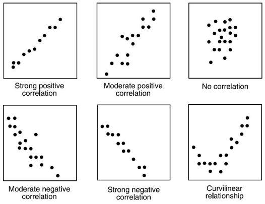
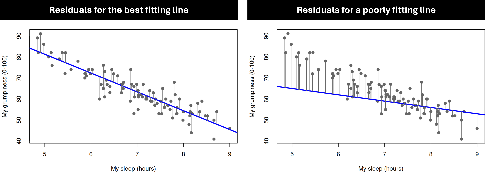



# Getting started

In this lab, we'll be covering our set of statistical tests for this course, correlations and regressions. Before starting this lab, make sure to have read **Chapter 11: Correlation: Do Two Things Co-Occur?** and **Chapter 12: Linear Regression: Correlation with Prediction** from your textbook.

::: callout-note
## Learning objectives

By the end of this lab, you should be able to:

-   Define and describe the logic underyling correlations and linear regressions
-   Identify situations in which it is appropriate to use a correlation or linear regression
-   Use `R` to conduct and interpret the output of a correlation
-   Report the output of an correlation using APA formatting
-   Use `R` to conduct and interpret the output of a linear regression
-   Report the output of a linear regression using APA formatting
:::

Up to this point, we have learned about different statistical tests to compare data across different groups—however, group comparisons are only one type of research design that we can work with. Earlier in this course, we had learned about **correlational research designs** which we can use when we are interested in looking at the relationship between two (or more) variables, with each participant in our sample providing data for each of the variables of interest. Oftentimes in a correlational research design, our variables of interest will be quantitative, so we will not be able to use something like a t-test or ANOVA can only compare across categorical groups. Here, we will be learning about two statistical tools that we can use to analyze data from a correlation research design: the **correlation** and the **linear regression**.

# The correlation

The **correlation** is one of the most useful and commonly used statistical tools, allowing us to describe and quantify the relationship between two quantitative variables. To understand what we mean by this, it will be helpful to visualize different types of relationships between two variables. As we had learned previously, a **scatterplot** is a helpful tool to do this – below are a few examples of different scatterplots depicting different types of relationships:

{fig-alt="A series of scatterplots showing different types of relationships between two variables. From left to right on the top row, there are three scatterplots depicting a strong positive correlation, moderate positive correlation, and no correlation. From left to right on the bottom row, there are three scatterplots depicting a moderate negative correlation, strong negative correlation, and curvilinear relationship." fig-align="center"}

When we are working with a correlation, we are typically referencing **Pearson's correlation coefficient (r)**, which describes the relationship between two continuous, quantitative variables. This value can range between -1.0 and +1.0. The correlation coefficient tells us about two properties of our relationship:

1.  The **direction** of the relationship, which tells us how the variables are changing with one another. If the value of r is positive, then we have a **positive correlation**, where both variables change in the same direction (e.g., if one variable goes up, the other variable goes up). Conversely, if the value of r is negative, then we have a **negative correlation**, where both variables change in different directions (e.g., if one variable goes up, the other variable goes down).
2.  The **strength** of the relation, which tells us how closely the data follow the relationship. At its extremes, an r value with a magnitude of 1 would indicate a **perfect linear relationship**, where all data follow a straight line perfectly, whereas an r value with a magnitude of 0 would indicate **no relationship** between the two variables. Importantly, a Pearson's correlation can only capture **linear relationships**, where the relationship can be described by a straight line.

::: callout-caution
## Try it yourself

To help develop your intuition for the Pearson's correlation coefficient, you can practice guessing the r value for different scatterplots here: <https://guessthecorrelation.com/> On each round, you will be shown a scatterplot and asked to guess the corresponding correlation coefficient. Try to beat my high score!

{fig-alt="Dr. Hong's current high score on Guess the Correlation" fig-align="center"}
:::

When computing the correlation coefficient, we first need to consider the **covariance** between two variables. When we first learned about variances, we were aiming to describe the amount of variability that we can expect to see in a given set of data. When working with two variables, we will expect some degree of variance in both – what the covariance tells us is how much these two will vary with one another.

A Pearson's correlation coefficient can be calculated using the following formula:

$$ 
r=\dfrac{\Sigma(X-M_X)(Y-M_Y)}{\sqrt{\Sigma(X-M_X)^2\Sigma(Y-M_Y)^2}}=\dfrac{SP}{\sqrt{SS_XSS_Y}} 
$$

This formula is a bit messy, but conceptually, it follows the same underlying logic as our other test statistics. Here, we are working with two variables, X and Y. Note that because we are using a correlational research design, we are not manipulating either variable so we do not need to distinguish between independent and dependent variables. We first compute the **sum of products (SP)**, which we can use to capture the covariance between X and Y, akin to how the **sum of squares (SS)** captures the variance in a variable. Since it would be difficult to interpret this sum of products alone, we can compute the Pearson's correlation coefficient, r, by comparing this value to the variance we would expect to see in X and Y alone (i.e., SS~X~ and SS~Y~). This has the added benefit of standardizing our values between a potential range of -1.0 and +1.0 to aid in interpretation.

We can then use this correlation coefficient to test hypotheses following the same null hypothesis significance testing (NHST) procedure we have been using throughout this course:

1.  State our hypotheses
2.  Create our decision rule
3.  Compute our observed test statistic
4.  Make a decision
5.  Report our results

# Does being wealthy distort perceptions of wealth inequality?

In this final lab, we'll be working with a dataset from a study by Dawtry, Sutton, & Sibley (2015)[^1]. Here, the researchers wanted to examine why people differ in their assessments of the increasing wealth inequality within developed nations. Previous research reveals that most people desire a society in which the overall level of wealth is high and that wealth is spread somewhat equally across society. However, support for this approach to income distribution changes across the social strata. In particular, wealthy people tend to view society as already wealthy and thus are satisfied with the status quo, and less likely to support redistribution. The authors propose that one reason wealthy people tend to view the current system is fair is because their social-circle is comprised of other wealthy people, which biases their perceptions of wealth, which leads them to overestimate the mean level of wealth across society.

[^1]: The activity in this lab adapts and builds upon materials provided by Dr. Kevin P. McIntyre via [Open Stats Labs](https://sites.google.com/view/openstatslab/).

To test this hypothesis, the authors conducted a study with 305 participants, recruited from an online participant pool. Participants reported their own annual household income, the income level of those within their own social circle, and the income for the entire population. Participants also rated their perception of the level of equality/inequality across their social circle and across society, their level of satisfaction with and perceived fairness of the current system, their attitudes toward redistribution of wealth (measured using a four-item scale), and their political preference. For more details on the methods, please refer to Dawtry, Sutton, & Sibley (2015) Study 1a.

::: callout-caution
## Check your understanding

Based on this description, what type of research design is being used? What are the independent and dependent variables (if any)?
:::

## Exploring the data

As usual, the first step we will take is exploring and looking at our data!

**Before we start, let's load in the packages that we'll need for this lab.**

```{webr}
# Download and load the tidyverse package (this might take a few moments)  
install.packages("tidyverse", quiet = TRUE)  
library(tidyverse)
```

**Let's use the `read.csv()` function to load in the data for us to use.**

```{webr}
# Use the read.csv() function to load in the dataset from Dawtry, Sutton, & Sibley (2015) 
data <- read.csv("data/wealth-inequality.csv")

# Let's return the value from our data object by typing its name   
data
```

There are quite a few variables here that may be of interest:

-   `Household_Income`: Reported annual household income (in USD)
-   `Political_Preference`: Reported political orientation on a 9-point scale (1 = "Extremely liberal", 9 = "Extremely conservative")
-   `Population_Inequality_Gini_Index`: To avoid potential response biases, participants estimated the percentage of people in the entire US population that fell within certain income intervals (e.g., \$0-\$15,000, \$15,000-\$30,000, etc., through \$150,000+). This was then used to calculate a Gini index, that provides a measure of income inequality. A Gini index of 0% indicates perfect equality (i.e., everyone has the same income), while 100% indicates perfect inequality (i.e., a single person holds the entire income and everyone else has zero)
-   `Population_Mean_Income`: The same estimated distributions were also used to calculate an estimated population mean annual household income (in USD)
-   `Social_Circle_Inequality_Gini_Index`: The same procedure described above was also done in relation to their social contacts (e.g., friends, family, colleagues, acquaintances) and was used to calculate a Gini index for their social circle
-   `Social_Circle_Mean_Income`: Similarly, this estimated social circle distribution was used to calculate an estimated social circle mean annual household income (in USD)
-   `Fairness_Satisfaction`: Reported perceived fairness and satisfaction, averaged across two questions on a 9-point scale (e.g., "To what extent do you feel that household incomes are fairly-unfairly distributed across the U.S. population?"; 1 = "Extremely fair", 9 = "Extremely unfair"). These responses were reverse-coded, so that higher values indicate greater perceived fairness and satisfaction
-   `Support_Redistribution`: Reported support for redistribution, averaged across four questions on a 6-point scale (e.g., "The government should redistribute wealth through heavy taxes on the rich."; 1 = "Strongly disagree", 6 = "Strongly agree")

For this first part of this activity, let's use a correlation to explore the relationship between perceived fairness and satisfaction (i.e., `Fairness_Satisfaction`) and support for redistribution (i.e., `Support_Redistribution`).

We can first calculate our descriptive statistics for these variables – particularly, our mean and standard deviation.

**Let's use the code below to calculate the mean and standard deviation for `Fairness_Satisfaction`** **and `Support_Redistribution`** **scores. Here, the `across()`** **function allows us to `summarise()`** **across multiple columns. Don't worry too much about understanding the nuts and bolts of the code.**

```{webr}
#| exercise: ex_1
# Use the code below to calculate descriptive statistics for the Dawtry, Sutton, & Sibley (2015) dataset
data |>
  summarise(across(c(______, ______),
                   list(mean = mean, sd = sd)))
```

Let's take a look at what the relationship between these two variables looks like using a scatterplot.

**Use the code below to create a scatterplot to visualize the relationship between `Fairness_Satisfaction`** **and `Support_Redistribution`** **scores. When creating scatterplots, it can sometimes be helpful to increase the transparency of your points to better depict overlapping points – in the example below, this is set by the `alpha`** **parameter within `geom_point()`.**

```{webr}
#| exercise: ex_2
# Use the code below to visualize the relationship between perceived fairness and satisfaction and support for redistribution
data |>   
  ggplot(aes(x = ______, y = ______)) +   
  geom_point(alpha = 0.2) +
  labs(x = "______",        
       y = "______") +   
  theme_minimal()
```

This plot should help you form an intuition for the resulting hypothesis test will turn out. Does it look like there is a relationship between these two variables? If so, what is the direction and strength of this relationship? Is it appropriate to use a Pearson's correlation coefficient? If so, what do we expect the correlation coefficient to be? Do we expect to see a big p-value or a small p-value?

## Conducting a correlation

Now, let's go through the five steps of the NHST procedure using the Pearson's correlation coefficient.

::: callout-tip
## Activity 1

Let's use a Pearson's correlation coefficient to test the relationship between perceived fairness and satisfaction (i.e., `Fairness_Satisfaction`) and support for redistribution (i.e., `Support_Redistribution`). Use a two-tailed test with an α = .05.
:::

1.  In plain words, what are the statistical hypotheses? What are the null and alternative hypotheses?

2.  The next step that we usually undergo in our NHST procedure is to find the critical values. Since we are computing this using `R`, we can compare our calculated *p-*value to the α level directly. As a reminder, our α Ievel sets our criteria for determining whether a difference is statistically significant.

3.  To compute the Pearson's correlation coefficient, we'll be using the `cor.test()` function. For this function, we will input the two sets of data that we are interested in. We can also specify an `alternative` parameter, which tells us what type of alternative test we want to use. This can be either "two.sided", "less", or "greater". By default, this will be set to "two.sided", meaning a two-tailed hypothesis test.

    **Use the code below to compute the Pearson's correlation coefficient to** **test the relationship between perceived fairness and satisfaction (i.e., `Fairness_Satisfaction`) and support for redistribution (i.e., `Support_Redistribution`**)**. As a reminder, we use the `$` symbol to access specific variables within our data.**

    ```{webr}
    #| exercise: ex_3
    # Use the code below to test the relationship between perceived fairness and satisfaction and support for redistribution
    cor.test(______, ______, alternative = "two.sided")
    ```

4.  Based on these results, will you reject or fail to reject the null hypothesis? How does your observed test statistic compare to your decision criteria? Would you consider your results statistically significant? In plain words, how would you describe the results of your analyses?

    Note that we need to be particularly mindful here when interpreting correlations. Previously, we learned the saying that "correlation does not equal causation" – in other words, we can only make **association claims** when working with correlations, not causal claims. For example, correlations cannot adequately capture non-linear relationships or effects of third variables, and can be misleading if there is a restriction of range or heterogeneous groups in our sample. Even if we do find a correlation, these may be **spurious** in nature, arising by chance alone – you can peruse different examples of spurious correlations here: <https://www.tylervigen.com/spurious-correlations>

## Effect sizes

One nice feature of the correlation coefficient is that it assesses the strength of the relationship, providing us with a measure of practical significance. When we square this value, we calculate the **coefficient of determination (R^2^)**, which tells us the proportion of the total variability that can be explained by our effect – this is the same interpretation as the eta-squared (η^2^) value that we calculated in the context of the ANOVA.

The following table provides a rough rule of thumb for interpreting an r and R^2^ value:

| r    | R^2^ | Evaluation of effect size |
|------|------|---------------------------|
| 0.10 | 0.01 | Small effect              |
| 0.30 | 0.09 | Medium effect             |
| 0.50 | 0.25 | Large effect              |

To calculate R^2^, we will use the `cor()` function that only returns the correlation coefficient, rather than the output of the hypothesis test. For the `cor()` function, we just need to specify the two sets of data that we are interested in.

**Use the code below to find the R^2^ as a measure of effect size for our correlation between perceived fairness and satisfaction (i.e., `Fairness_Satisfaction`) and support for redistribution (i.e., `Support_Redistribution`**)**. As a reminder, we use the `$` symbol to access specific variables within our data.**

```{webr}
#| exercise: ex_4
# Use the code below to find the R squared as a measure of effect size for our correlation
cor(______, ______)^2
```

How should we interpret this R^2^ value? What does this tell us about the practical significance of our result?

## Reporting our results

Lastly, we need to report the results from our analyses using APA formatting. As a general format, we will need to include the following elements when reporting our results:

-   What statistical test we used
-   Descriptive statistics for our data (e.g., mean, standard deviation)
-   The calculated test statistic (r), degrees of freedom, and *p*-value
-   The effect size (R^2^) and interpretation.
-   If our findings are significant, we also want to report the direction of the relationship

As an example, we could report the findings of our analysis like:

> "A Pearson's correlation coefficient showed that there was a significant positive relationship between perceived fairness and satisfaction (M = 3.54, SD = 2.02) and support for redistribution (M = 3.91, SD = 1.15), r(303) = -0.70, *p* \< .001 , R^2^ = 0.49. This was a large effect – perceived fairness and satisfaction explained 49% of the variance in support for redistribution."

## An introduction to linear regression

For the last part of this lab (and course!), we will be introducing the **linear regression**, which characterizes the line of best fit in our data. This typically works hand-in-hand with the correlation, specifically enabling us to make predictions using our data. Regressions are one of the most fundamental tools in statistics – in fact, if you continue along your statistics journey, you will find out that all of the statistical tools that we have learned thus far (e.g., t-tests, ANOVAs, etc.) can be thought of as a special form of regression. However, we will save that for another time, and will focus today on the basic concepts.

To start off with, we can review the equation of the line, which you have likely encountered in your high school mathematics class:

$$
y=mx+b
$$

Here, $x$ and $y$ represent two different variables. $m$ represents the **slope** of the line, telling us us how steep the line is by describing how much $y$ changes as we increase $x$ by one unit. $b$ represents the **y-intercept**, telling us where the line crosses the y-axis by describing what the value of $y%$ is when $x=0$. When we are calculating the regression of the line, we will essentially be using the same formula, though it is oftentimes depicted as:

$$
\hat{Y}=b_0+b_1X
$$

There are a few subtle differences. Firstly, we notice that we used the term $\hat{Y}$ (read as "y-hat") instead of $y$. This is because we want to make the distinction between our actual data, $Y$, and our predicted data, $\hat{Y}$. Secondly, we replaced our coefficients so that they are both denoted by the letter $b$, distinguished by their subscripts. $b_0$ will always refer to the y-intercept, while $b_1$ refers to the slope.

So, how do we calculate the regression line that best fits our data? To understand this, we will first introduce the idea of a **residual**, which describes the difference we see between our our actual data, $Y$, and our predicted data, $\hat{Y}$. To visualize what this looks like, let's look at the following two graphs depicting the relationship between hours slept and grumpiness. On the left hand side, we see the best fitting line and on the right hand side, we see a poorly fitting line. When deciding on the best fitting line, we want to minimize the residuals, or in other words, reduce the degree of error in our predictions. To see how the linear regression relates to the correlation, you can explore the demo here: <https://rpsychologist.com/correlation> – to see the associated residuals, you can go into the Settings and tick the checkbox for Residuals.

{fig-alt="Two scatterplots, with a best fitting line on the left and a poorly fitting line on the left. Each graph also depicts the residuals between the data points and the corresponding line."}

## Conducting a linear regression

The actual calculations underlying a linear regression are a bit tedious, but we can use `R` to conduct a linear regression for us via a function called `lm()` , short for "linear model". The syntax for `lm()` takes the form of *y* \~ *x*, where *y* is the name of the variable that we want to predict and *x* is the name of the variable that we want to use to predict. Note here that this is similar to the syntax we had learned previously for our independent measures t-test and one-way ANOVA, with *dv* \~ *iv* – however, we do not need to distinguish between these here since we are working with a correlational research design.

**Use the code below to find the equation of the regression line predicting support for redistribution (i.e., `Support_Redistribution`**) **from perceived fairness and satisfaction (i.e., `Fairness_Satisfaction`). As a reminder, we use the `$` symbol to access specific variables within our data.**

```{webr}
#| exercise: ex_5
# Use the code below to find the regression line predicting support for redistribution from perceived fairness and satisfaction
lm(______ ~ ______)
```

Here, we have two separate pieces of information, telling us that $b_0=5.32$ and $b_1=-0.40$, giving us a regression line of $\hat{Y}=5.32-0.40X$ . We can then use this to make an informed guess for how much someone would support redistribution knowing their perceived fairness and satisfaction.

**Let's imagine that we know that someone believes that there is very low fairness in household incomes, corresponding to a `Fairness_Satisfaction` score of 1.5. Use the code below to predict what their support for redistribution knowing what the regression line is.**

```{webr}
# Use the code below to predict how much someone with a Fairness_Satisfaction score of 1.5 would support redistribution
# First, input the corresponding values
b0 = ______
b1 = ______
x = ______

# The above values are then inputted into the equation below
b0 + (b1 * x)
```

There are quite a few complicated functions we can also do with the `lm()` function itself – for example, we can go through the NHST procedure to test the statistical significance of a given regression term (i.e., using a one-sample t-test to assess whether our slope or intercept is meaningfully different than 0). However, for the time being, we will be solely using it to find the equation of our line of best fit.

::: callout-tip
## Activity 2

In the above analysis, we found a significant relationship between perceived fairness and satisfaction and support for redistribution. Let's return to the authors' original research question and investigate the relationship between the estimated social circle mean income (`Social_Circle_Mean_Income`) and support for redistribution (`Support_Redistribution`). Adapt the code above to evaluate the relationship between these two variables, using a two-tailed hypothesis test and α = .05. Calculate the associated effect size and make sure to report your findings using APA style.
:::

# That's all for now, great work!

**Use what you have learned to answer some questions about this lab in the corresponding Assignment on CourseLink!**

## References

Dawtry, R. J., Sutton, R. M., & Sibley, C. G. (2015). Why Wealthier People Think People Are Wealthier, and Why It Matters: From Social Sampling to Attitudes to Redistribution: From Social Sampling to Attitudes to Redistribution. *Psychological Science*, *26*(9), 1389-1400. <https://doi.org/10.1177/0956797615586560>
